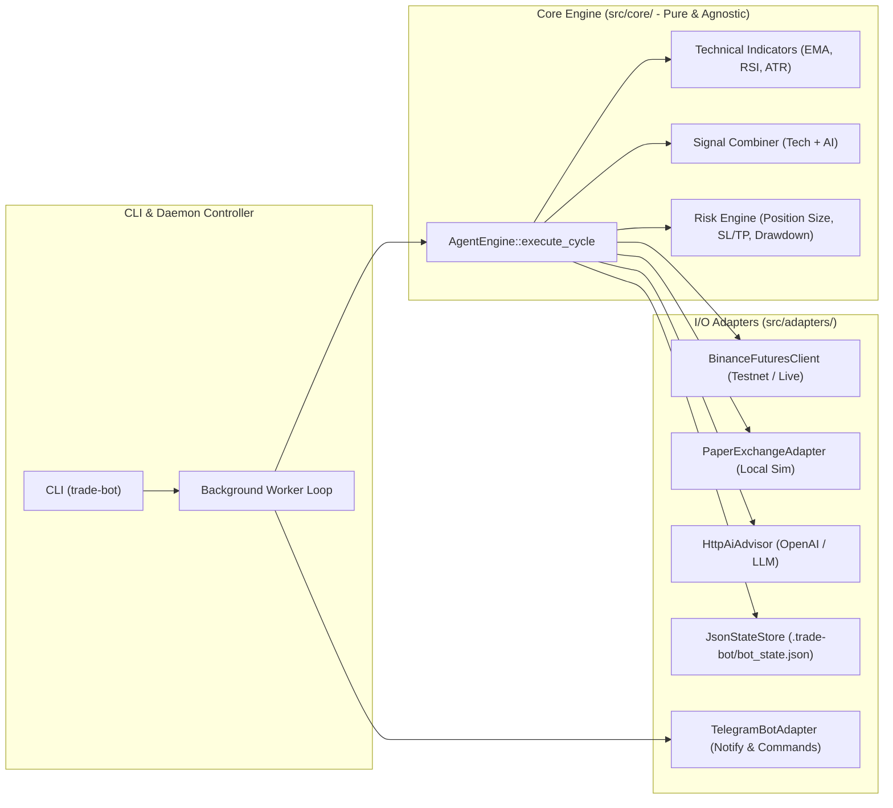
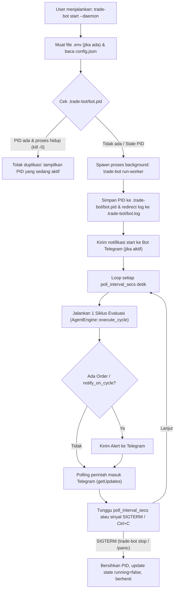
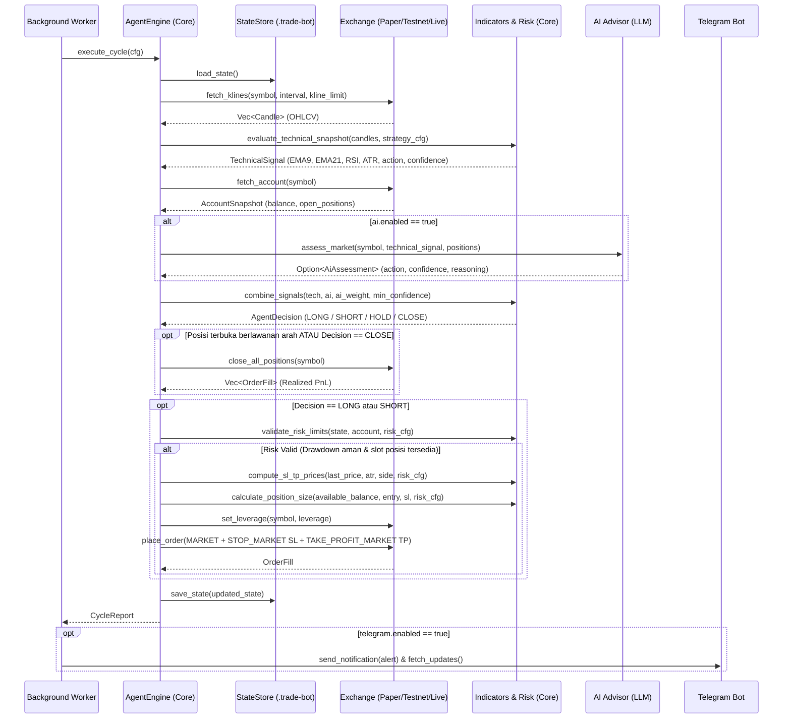
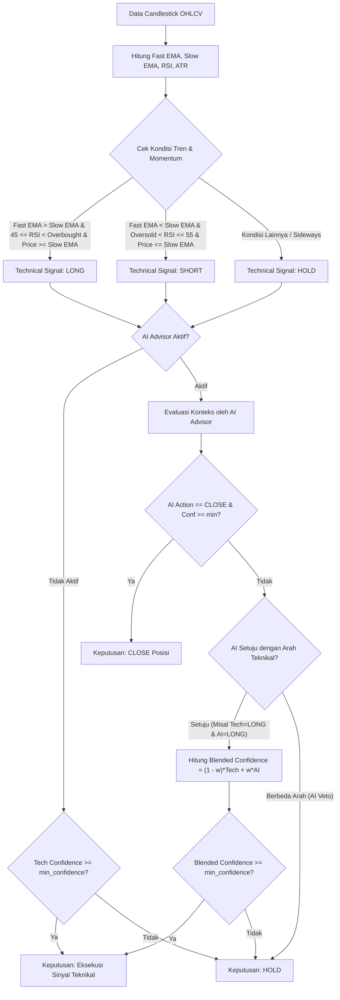
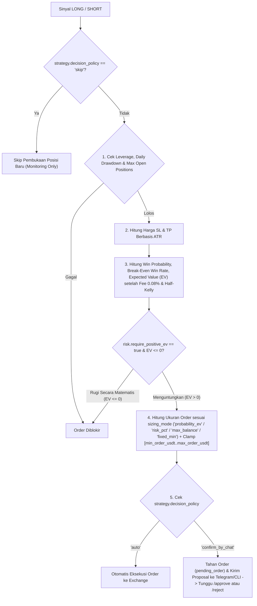
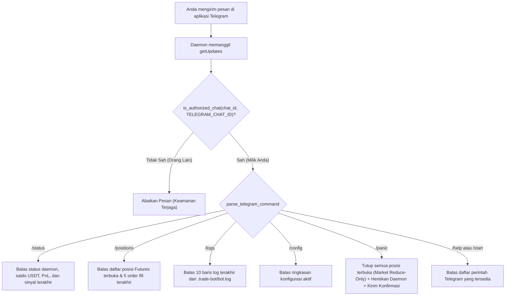

# Cara Kerja Trade-Bot (Arsitektur & Alur Mermaid)

Dokumen ini menjelaskan cara kerja **Trade-Bot** secara menyeluruh mulai dari siklus hidup proses *background daemon*, perhitungan indikator teknikal (`EMA`, `RSI`, `ATR`), penggabungan sinyal dengan **AI Advisor**, kalkulasi manajemen risiko (*Position Sizing*, *Stop-Loss*, *Take-Profit*, *Daily Drawdown Circuit Breaker*), hingga pemantauan dan kontrol jarak jauh melalui **Bot Telegram**.

---

## 1. Gambaran Umum Arsitektur (Ports & Adapters)

Trade-Bot dirancang menggunakan pola **Hexagonal Architecture (Ports & Adapters)** yang memisahkan **Core Logic** (murni, deterministik, 100% bebas I/O) dari **Adapters** (komunikasi HTTP ke Binance, LLM, Telegram, dan penyimpanan file lokal).

---

## 2. Alur Siklus Hidup Background Daemon (`start --daemon`)

Saat pengguna menjalankan `trade-bot start --daemon`, proses utama CLI tidak mengunci terminal melainkan men-*spawn* proses anak (*detached worker*) di background:

---

## 3. Sequence Diagram: Satu Siklus Evaluasi Trading (`execute_cycle`)

Berikut urutan interaksi antar komponen pada setiap satu siklus evaluasi:

---

## 4. Logika Evaluasi Sinyal Teknikal & Penggabungan AI (`Decision Tree`)

### A. Sinyal Indikator Teknikal (`evaluate_technical_snapshot`)
1. **Exponential Moving Average (`fast_ema` vs `slow_ema`):** Menentukan arah tren utama.
2. **Relative Strength Index (`rsi`):** Mencegah beli di pucuk (*overbought*) atau jual di dasar (*oversold*).
3. **Average True Range (`atr`):** Mengukur volatilitas rata-rata dalam satuan harga untuk menentukan jarak *Stop-Loss* dan *Take-Profit* yang adaptif.

### B. Penggabungan dengan AI Advisor (`combine_signals`)

---

## 5. Mekanisme Kebijakan Keputusan (`decision_policy`), Batas Pembelian & Kalkulasi Probabilitas Anti-Rugi (`Expected Value`)

Setiap kali sinyal `LONG` atau `SHORT` lolos dari evaluasi strategi, order diproses melalui **Risk & Probability Engine** (`src/core/risk.rs`) dan **Decision Policy** (`src/core/agent.rs`):

### A. 3 Mode Pengambilan Keputusan (`strategy.decision_policy`)
1. **`"auto"` (Otomatis Beli):** Begitu sinyal valid dan lolos kalkulasi probabilitas & risiko, bot langsung mengeksekusi order ke exchange.
2. **`"confirm_by_chat"` (Hold & Konfirmasi via Chat/CLI):** Bot **menahan order** di `pending_order`, mengirimkan info lengkap ke Telegram (harga entry, SL, TP, nilai USDT, probabilitas menang, *break-even win rate*, dan *Expected Value*), lalu menunggu Anda mengetik **`/approve`** (atau `/buy`) di chat Telegram (atau `./target/release/trade-bot approve` di CLI) untuk membeli, atau **`/reject`** untuk membatalkan.
3. **`"skip"` (Skip Eksekusi):** Bot tetap menganalisis pasar dan mengirim laporan sinyal, tetapi melewati semua pembukaan posisi baru.

### B. 4 Mode Ukuran Pembelian (`risk.sizing_mode`) & Batas Nominal (`min_order_usdt` / `max_order_usdt`)
- **`"probability_ev"` (Default — Hitung Probabilitas & Half-Kelly):** Menyesuaikan ukuran pembelian secara proporsional dengan keunggulan probabilitas (*Half-Kelly Criterion*) setelah memperhitungkan *round-trip taker fee* `0.08%`.
- **`"risk_pct"`:** Berdasarkan persentase risiko saldo (`risk_per_trade_pct`) terhadap jarak *Stop-Loss*.
- **`"max_balance"`:** Menggunakan daya beli maksimum sesuai saldo tersedia & *leverage* (atau dibatasi oleh `max_order_usdt`).
- **`"fixed_min"`:** Menggunakan batas nominal pembelian minimum tetap (`min_order_usdt`).
- Seluruh mode di atas selalu di-*clamp* di antara **`risk.min_order_usdt`** (batas bawah pembelian, misal `10.0` USDT) dan **`risk.max_order_usdt`** (batas atas pembelian; `0.0` = otomatis mengikuti batas saldo & leverage).

### C. Rumus Anti-Rugi (`evaluate_trade_probability` & `require_positive_ev`)
1. **Net Reward & Net Risk (setelah estimasi fee transaksi round-trip `0.08%`):**
   - $\text{Net Reward \%} = \max\left(0,\; \frac{|\text{Take Profit} - \text{Entry}|}{\text{Entry}} - 0.0008\right)$
   - $\text{Net Risk \%} = \frac{|\text{Entry} - \text{Stop Loss}|}{\text{Entry}} + 0.0008$
   - $\text{Net R:R} = \frac{\text{Net Reward \%}}{\text{Net Risk \%}}$
2. **Break-Even Win Rate & Expected Value (EV):**
   - $\text{Break-Even Win Rate} = \frac{1}{1 + \text{Net R:R}}$
   - $\text{Expected Value (R)} = (p \times \text{Net R:R}) - (1 - p)$
   - Jika `risk.require_positive_ev = true`, maka transaksi **wajib** memiliki $\text{EV} > 0$ dan $p > \text{Break-Even Win Rate}$ agar tidak merugi secara ekspektasi matematis.

---

## 6. Alur Pemantauan & Kontrol Interaktif via Bot Telegram

Saat `telegram.enabled = true`, daemon menjalankan dua fungsi komunikasi dengan Telegram:
1. **Push Notifications:** Mengirim pesan otomatis ke Telegram Anda ketika daemon menyala, ketika ada order baru dieksekusi (`notify_on_trade = true`), ketika posisi ditutup, atau setiap siklus (`notify_on_cycle = true`).
2. **Interactive Command Polling (`listen_commands = true`):** Daemon mengambil pesan masuk dari Telegram (`getUpdates`), memverifikasi bahwa `chat.id` pengirim sama dengan `TELEGRAM_CHAT_ID` Anda, lalu mengeksekusi perintah:

