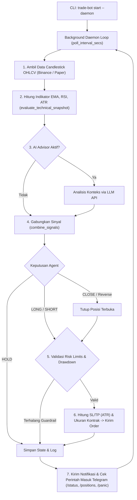

# Trade-Bot — Binance USDⓈ-M Futures Hybrid Trading Bot Agent

Bot trading berjangka (**Binance USDⓈ-M Futures / USDT-Margined**) berbasis **Rust** dengan antarmuka **CLI**, **Built-in Background Daemon**, dan **Monitoring Interaktif via Bot Telegram**.

Menggunakan arsitektur **Hybrid Agent** yang menggabungkan:
1. **Indikator Teknikal Murni (`EMA`, `RSI`, `ATR`)** — identifikasi tren, filter momentum *overbought/oversold*, serta volatilitas.
2. **AI / LLM Market Advisor Opsional** — konfirmasi sinyal atau veto terhadap kondisi pasar anomali melalui endpoint kompatibel OpenAI Chat Completions.
3. **Risk Guardrails & Circuit Breaker** — perhitungan ukuran posisi otomatis berdasarkan `% risiko per trade`, *Stop-Loss* & *Take-Profit* berbasis kelipatan `ATR`, batas *leverage*, serta pengaman *Max Daily Drawdown*.
4. **Integrasi Bot Telegram (Notifikasi & Remote Command)** — pantau status, posisi, log, atau jalankan *panic close* langsung dari aplikasi Telegram.

> Dokumentasi mendalam mengenai arsitektur dan diagram alur kerja (**Mermaid**) dapat dibaca di **[HOW_IT_WORKS.md](./HOW_IT_WORKS.md)**.
> Panduan lengkap cara export **`trade-bot.exe`** untuk **Windows**, menjalankan **Setup Wizard Interaktif**, penyimpanan database **SQLite (`.db`)**, dan **Multi-Worker** dapat dibaca di **[WINDOWS_GUIDE.md](./WINDOWS_GUIDE.md)**.

---

## Ringkasan Alur Kerja Bot (Mermaid Flow)



*(Lihat penjelasan detail beserta 5 diagram Mermaid lengkap di [HOW_IT_WORKS.md](./HOW_IT_WORKS.md)).*

---

## 1. Cara Build

```bash
# Build mode debug (cepat untuk development)
cargo build

# Atau build mode release (dioptimasi untuk produksi)
cargo build --release
```

Binary akan tersedia di:
- Debug: `./target/debug/trade-bot`
- Release: `./target/release/trade-bot`

---

## 2. Inisialisasi & Konfigurasi (`config.json` / SQLite `config.db` & `.env`)

Anda dapat menggunakan **Setup Wizard Interaktif** (mendukung file `.json` maupun database **SQLite `.db`**) beserta pengecekan otomatis kelayakan konfigurasi (`check-config`):

```bash
# Jalankan Setup Wizard Interaktif
./target/release/trade-bot wizard

# Atau simpan konfigurasi langsung ke database SQLite (config.db)
./target/release/trade-bot --config config.db wizard

# Cek apakah file konfigurasi & environment variable sudah memenuhi seluruh requirement
./target/release/trade-bot check-config
```

Atau buat file konfigurasi awal (`config.json` atau `config.db`) secara langsung:

```bash
./target/release/trade-bot init-config
```

Jika ingin menimpa konfigurasi yang sudah ada:

```bash
./target/release/trade-bot init-config --force
```

Anda juga dapat menampilkan penjelasan seluruh parameter konfigurasi beserta nilai aktifnya kapan saja melalui perintah:

```bash
./target/release/trade-bot config-info
```

### Contoh Isi `config.json`

```json
{
  "mode": "paper",
  "symbol": "BTCUSDT",
  "interval": "5m",
  "kline_limit": 100,
  "poll_interval_secs": 15,
  "data_dir": ".trade-bot",
  "strategy": {
    "decision_policy": "auto",
    "fast_ema_period": 9,
    "slow_ema_period": 21,
    "rsi_period": 14,
    "rsi_overbought": 70.0,
    "rsi_oversold": 30.0,
    "atr_period": 14,
    "min_confidence": 0.6
  },
  "risk": {
    "sizing_mode": "probability_ev",
    "min_order_usdt": 10.0,
    "max_order_usdt": 0.0,
    "require_positive_ev": true,
    "leverage": 3,
    "max_leverage": 10,
    "risk_per_trade_pct": 0.01,
    "atr_sl_multiplier": 1.5,
    "atr_tp_multiplier": 3.0,
    "max_daily_drawdown_pct": 0.05,
    "max_open_positions": 1,
    "initial_paper_balance_usdt": 1000.0
  },
  "ai": {
    "enabled": false,
    "endpoint_url": "https://api.openai.com/v1/chat/completions",
    "model": "gpt-4o-mini",
    "api_key_env": "AI_API_KEY",
    "weight": 0.35
  },
  "exchange": {
    "api_key_env": "BINANCE_API_KEY",
    "api_secret_env": "BINANCE_API_SECRET",
    "testnet_base_url": "https://testnet.binancefuture.com",
    "live_base_url": "https://fapi.binance.com",
    "recv_window_ms": 5000
  },
  "telegram": {
    "enabled": false,
    "bot_token_env": "TELEGRAM_BOT_TOKEN",
    "chat_id_env": "TELEGRAM_CHAT_ID",
    "api_base_url": "https://api.telegram.org",
    "notify_on_trade": true,
    "notify_on_cycle": false,
    "listen_commands": true
  }
}
```

---

## 3. Referensi Lengkap Fungsi Setiap Config Key (`config.json`)

### A. Pengaturan Umum (Root)
| Key | Tipe | Default | Fungsi & Dampak |
|-----|------|---------|-----------------|
| `mode` | `string` | `"paper"` | Mode eksekusi bot: `"paper"` (simulasi lokal aman tanpa dana asli), `"testnet"` (Binance Futures Testnet), atau `"live"` (Binance USDⓈ-M Futures Mainnet). |
| `symbol` | `string` | `"BTCUSDT"` | Pasangan kontrak berjangka USDⓈ-M yang diperdagangkan (misal `"BTCUSDT"`, `"ETHUSDT"`, `"SOLUSDT"`). |
| `interval` | `string` | `"5m"` | Timeframe candlestick klines yang dianalisis (misal `"1m"`, `"5m"`, `"15m"`, `"1h"`, `"4h"`). |
| `kline_limit` | `usize` | `100` | Jumlah bar candlestick historis yang diambil setiap siklus untuk menghitung indikator. Harus lebih besar dari periode indikator terpanjang (`slow_ema_period` + 1). |
| `poll_interval_secs` | `u64` | `15` | Jeda waktu (dalam detik) antar siklus evaluasi ketika daemon berjalan di background. |
| `data_dir` | `string` | `".trade-bot"` | Direktori lokal tempat bot menyimpan `bot_state.json`, `bot.pid`, dan `bot.log`. |

### B. Pengaturan Strategi & Kebijakan Keputusan (`strategy.*`)
| Key | Tipe | Default | Fungsi & Dampak |
|-----|------|---------|-----------------|
| `strategy.decision_policy` | `string` | `"auto"` | Kebijakan pengambilan keputusan order: **`"auto"`** (otomatis beli saat sinyal & EV valid), **`"confirm_by_chat"`** (tahan order, kirim info proposal via chat Telegram/CLI, lalu beli saat Anda mengetik `/approve` atau `trade-bot approve`), atau **`"skip"`** (lewati pembukaan posisi baru, hanya analisis). |
| `strategy.fast_ema_period` | `usize` | `9` | Periode *Exponential Moving Average* cepat untuk mendeteksi pergerakan harga jangka pendek. Harus lebih kecil dari `slow_ema_period`. |
| `strategy.slow_ema_period` | `usize` | `21` | Periode *Exponential Moving Average* lambat sebagai acuan arah tren utama (*bullish* jika `fast_ema > slow_ema`, *bearish* jika `fast_ema < slow_ema`). |
| `strategy.rsi_period` | `usize` | `14` | Periode *Relative Strength Index* (Wilder's smoothing) untuk mengukur kekuatan dan kejenuhan momentum harga (`0..100`). |
| `strategy.rsi_overbought` | `f64` | `70.0` | Batas jenuh beli (*overbought*). Jika `RSI >= nilai ini`, sinyal `LONG` diblokir agar tidak membeli di pucuk harga. |
| `strategy.rsi_oversold` | `f64` | `30.0` | Batas jenuh jual (*oversold*). Jika `RSI <= nilai ini`, sinyal `SHORT` diblokir agar tidak menjual di dasar harga. |
| `strategy.atr_period` | `usize` | `14` | Periode *Average True Range* untuk mengukur volatilitas rata-rata per candle (digunakan sebagai dasar jarak Stop-Loss & Take-Profit dinamis). |
| `strategy.min_confidence` | `f64` | `0.60` | Ambang batas skor keyakinan (`0.0` s/d `1.0`) minimum agar keputusan sinyal dieksekusi menjadi order. Semakin tinggi nilainya, semakin selektif bot membuka posisi. |

### C. Manajemen Risiko, Batas Pembelian & Probabilitas Anti-Rugi (`risk.*`)
| Key | Tipe | Default | Fungsi & Dampak |
|-----|------|---------|-----------------|
| `risk.sizing_mode` | `string` | `"probability_ev"` | Mode penentuan ukuran pembelian: **`"probability_ev"`** (hitung probabilitas menang, *Expected Value* setelah fee, & *Half-Kelly*), **`"risk_pct"`** (berdasarkan `%` risiko terhadap jarak SL), **`"max_balance"`** (maksimum sesuai saldo tersedia & leverage), atau **`"fixed_min"`** (sebesar angka `min_order_usdt`). |
| `risk.min_order_usdt` | `f64` | `10.0` | Batas **minimum** nilai pembelian (*notional* USDT) per order. Jika saldo/kapasitas di bawah angka ini, order dibatalkan. |
| `risk.max_order_usdt` | `f64` | `0.0` | Batas **maksimum** nilai pembelian (*notional* USDT) per order (`0.0` = otomatis mengikuti batas saldo tersedia $\times$ `leverage` $\times 95\%$). |
| `risk.require_positive_ev` | `bool` | `true` | Wajibkan perhitungan matematis **Expected Value (EV) > 0** dan `win_probability > break_even_win_rate` (setelah dikurangi estimasi *round-trip taker fee* `0.08%`) agar tidak merugi secara ekspektasi matematis. |
| `risk.leverage` | `u32` | `3` | Besaran *leverage* yang diatur ke akun Binance Futures sebelum membuka posisi (`1x` s/d `max_leverage`). |
| `risk.max_leverage` | `u32` | `10` | Batas keras (*hard cap*) leverage maksimum yang diizinkan oleh Risk Engine. Jika `leverage > max_leverage`, order ditolak. |
| `risk.risk_per_trade_pct` | `f64` | `0.01` | Rasio saldo tersedia yang siap dipertaruhkan jika terkena Stop-Loss pada 1 transaksi (`0.01` = **1%** dari saldo). Menentukan ukuran kontrak otomatis. |
| `risk.atr_sl_multiplier` | `f64` | `1.5` | Kelipatan nilai `ATR` untuk menentukan jarak harga **Stop-Loss** dari harga entry ($\text{SL Distance} = \text{ATR} \times 1.5$). |
| `risk.atr_tp_multiplier` | `f64` | `3.0` | Kelipatan nilai `ATR` untuk menentukan jarak harga **Take-Profit** dari harga entry ($\text{TP Distance} = \text{ATR} \times 3.0$, menghasilkan *Risk:Reward Ratio* 1:2). |
| `risk.max_daily_drawdown_pct` | `f64` | `0.05` | *Circuit breaker* batas kerugian harian maksimum (`0.05` = **5%** dari saldo awal hari). Jika terlampaui, bot otomatis memblokir pembukaan posisi baru. |
| `risk.max_open_positions` | `usize` | `1` | Jumlah posisi terbuka maksimum yang diperbolehkan dalam satu waktu. |
| `risk.initial_paper_balance_usdt` | `f64` | `1000.0` | Modal saldo virtual awal (dalam USDT) saat menjalankan simulasi di mode `"paper"`. |

### D. Modul AI / LLM Market Advisor (`ai.*`)
| Key | Tipe | Default | Fungsi & Dampak |
|-----|------|---------|-----------------|
| `ai.enabled` | `bool` | `false` | Mengaktifkan (`true`) atau menonaktifkan (`false`) validasi sinyal kedua menggunakan LLM. |
| `ai.endpoint_url` | `string` | `"https://api.openai.com/v1/chat/completions"` | URL endpoint HTTP Chat Completions (kompatibel dengan OpenAI, OpenRouter, Groq, atau local LLM server). |
| `ai.model` | `string` | `"gpt-4o-mini"` | Nama model LLM yang dipanggil untuk menganalisis ringkasan indikator teknikal. |
| `ai.api_key_env` | `string` | `"AI_API_KEY"` | Nama variabel di file `.env` yang menyimpan API Key untuk layanan LLM tersebut. |
| `ai.system_prompt_env` | `string` | `"AI_SYSTEM_PROMPT"` | Nama variabel di file `.env` yang menyimpan instruksi *System Prompt* kustom untuk asisten tanya jawab `/query`. |
| `ai.weight` | `f64` | `0.35` | Bobot suara AI (`0.0` s/d `1.0`) saat menggabungkan skor *confidence* teknikal dan AI ($\text{Blended} = (1 - w)\cdot\text{Tech} + w\cdot\text{AI}$). |

### E. Koneksi Multi-Exchange Futures (`exchange.*`)
| Key | Tipe | Default | Fungsi & Dampak |
|-----|------|---------|-----------------|
| `exchange.provider` | `string` | `"binance"` | Provider bursa Futures yang digunakan: **`"binance"`** (Binance USDⓈ-M Futures), **`"bybit"`** (Bybit V5 Linear USDT Perpetual), atau **`"okx"`** (OKX V5 USDT-Margined Swap). |
| `exchange.api_key_env` | `string` | `"BINANCE_API_KEY"` | Nama variabel di `.env` tempat menyimpan API Key Futures Anda. |
| `exchange.api_secret_env` | `string` | `"BINANCE_API_SECRET"` | Nama variabel di `.env` tempat menyimpan API Secret Binance Futures Anda. |
| `exchange.testnet_base_url` | `string` | `"https://testnet.binancefuture.com"` | Endpoint REST API saat `mode = "testnet"`. |
| `exchange.live_base_url` | `string` | `"https://fapi.binance.com"` | Endpoint REST API saat `mode = "live"` (dan sumber klines publik untuk `paper`). |
| `exchange.recv_window_ms` | `u64` | `5000` | Batas waktu validitas tanda tangan request HMAC-SHA256 ke server Binance (dalam milidetik). |

### F. Integrasi Monitoring Bot Telegram (`telegram.*`)
| Key | Tipe | Default | Fungsi & Dampak |
|-----|------|---------|-----------------|
| `telegram.enabled` | `bool` | `false` | Mengaktifkan (`true`) atau menonaktifkan (`false`) fitur notifikasi & kontrol via Bot Telegram. |
| `telegram.bot_token_env` | `string` | `"TELEGRAM_BOT_TOKEN"` | Nama variabel di `.env` yang menyimpan token HTTP Bot Telegram dari `@BotFather`. |
| `telegram.chat_id_env` | `string` | `"TELEGRAM_CHAT_ID"` | Nama variabel di `.env` yang menyimpan Chat ID Telegram pribadi Anda (sebagai tujuan notifikasi sekaligus filter otorisasi perintah). |
| `telegram.api_base_url` | `string` | `"https://api.telegram.org"` | Base URL API server Telegram. |
| `telegram.notify_on_trade` | `bool` | `true` | Jika `true`, bot otomatis mengirim pesan ke Telegram setiap kali ada pembukaan posisi baru atau penutupan posisi. |
| `telegram.notify_on_cycle` | `bool` | `false` | Jika `true`, bot mengirim ringkasan di setiap siklus evaluasi walaupun tidak ada order baru (`HOLD`). |
| `telegram.listen_commands` | `bool` | `true` | Jika `true`, daemon mendengarkan perintah interaktif (`/status`, `/positions`, `/logs`, `/config`, `/panic`, `/help`) langsung dari chat Telegram Anda. |

---

## 4. Mengatur Kredensial (`.env`) & Setup Bot Telegram

Salin template `.env.example` menjadi `.env` (file `.env` otomatis dimuat oleh `trade-bot` saat dijalankan dan sudah diabaikan oleh `.gitignore`):

```bash
cp .env.example .env
```

Isi variabel di dalam `.env`:

```dotenv
BINANCE_API_KEY=api_key_binance_anda
BINANCE_API_SECRET=api_secret_binance_anda

# Opsional jika "ai.enabled": true
AI_API_KEY=api_key_openai_atau_llm_anda

# Opsional jika "telegram.enabled": true
TELEGRAM_BOT_TOKEN=123456789:AAExampleTelegramBotTokenFromBotFather
TELEGRAM_CHAT_ID=123456789
RUST_LOG=info
```

### Langkah Mudah Menghubungkan ke Bot Telegram:
1. Buka aplikasi Telegram, cari **`@BotFather`**, lalu kirim perintah `/newbot` untuk membuat bot baru dan salin **Bot Token** ke `TELEGRAM_BOT_TOKEN` di `.env`.
2. Kirim pesan `/start` ke bot yang baru Anda buat di Telegram.
3. Cari **`@userinfobot`** di Telegram (atau buka `https://api.telegram.org/bot<TOKEN_ANDA>/getUpdates` di browser setelah mengirim pesan ke bot Anda) untuk mengetahui angka **Chat ID** Anda, lalu isi ke `TELEGRAM_CHAT_ID` di `.env`.
4. Ubah `"telegram": { "enabled": true }` di `config.json`.
5. Uji koneksi Telegram langsung dari terminal:
   ```bash
   ./target/release/trade-bot telegram-test
   ```
6. Saat daemon berjalan (`./target/release/trade-bot start --daemon`), Anda dapat mengirim perintah berikut langsung dari chat Telegram Anda:
   - `/status` — Menampilkan status daemon, saldo USDT, PnL, dan sinyal terakhir.
   - `/positions` — Menampilkan daftar posisi Futures terbuka & 5 riwayat order terakhir.
   - `/actual-skill` (atau `/skills`) — Menampilkan dokumen **`skills.md`** berisi hasil pembelajaran berkelanjutan AI & aturan adaptif pasar.
   - `/query <pertanyaan>` (atau `/ask <pertanyaan>`) — **Tanya langsung ke AI di dalam bot** mengenai kondisi pasar, alasan keputusan bot, isi `skills.md`, posisi terbuka, maupun log daemon terakhir (menggunakan `AI_SYSTEM_PROMPT` di `.env`).
   - `/approve` (atau `/buy`) — Menyetujui & mengeksekusi order yang sedang ditahan (saat `decision_policy = "confirm_by_chat"`).
   - `/reject` — Membatalkan proposal order yang sedang ditahan.
   - `/logs` — Menampilkan 10 baris log terakhir dari daemon.
   - `/config` — Menampilkan ringkasan konfigurasi aktif.
   - `/panic` — **Darurat:** Menutup seluruh posisi terbuka secara instan & menghentikan daemon.
   - `/help` — Menampilkan daftar bantuan perintah.

---

## 5. Cara Menjalankan Bot (CLI & Background Daemon)

```bash
# 1. Menjalankan di background (Daemon Mode — Default)
./target/release/trade-bot start --daemon

# 2. LIVE INTERACTIVE MONITOR (Dashboard real-time dengan animasi spinner & live log)
#    Tekan Ctrl+C kapan saja untuk keluar dari layar monitor (daemon tetap berjalan di background)
./target/release/trade-bot monitor

# 3. Mengecek status daemon satu kali (snapshot)
./target/release/trade-bot status

# 4. Menyetujui atau membatalkan pending order (jika decision_policy = "confirm_by_chat")
./target/release/trade-bot approve
./target/release/trade-bot reject

# 5. Melihat posisi aktif & riwayat order fill
./target/release/trade-bot positions

# 5. Melihat 50 baris log terakhir ATAU mengikuti log secara live (-f / --follow)
./target/release/trade-bot logs -n 50
./target/release/trade-bot logs -f

# 6. Menjalankan Desktop App GUI Visual (atau cukup Double-Click trade-bot.exe tanpa argumen)
./target/release/trade-bot gui --port 8787

# 7. Tanya langsung ke AI seputar data trading bot, log, & skills (/query)
./target/release/trade-bot query "kenapa siklus terakhir belum beli?"

# 8. Melihat hasil pembelajaran AI berkelanjutan (skills.md)
./target/release/trade-bot actual-skill

# 7. Menjalankan Setup Wizard Interaktif & Mengecek Requirement Config
./target/release/trade-bot wizard
./target/release/trade-bot check-config

# 8. Menjalankan Multi-Worker secara aman (isolasi state, PID, log, & skills.md per worker)
./target/release/trade-bot --config config_eth.db --worker-id eth-worker start --daemon

# 9. Melihat penjelasan seluruh config key beserta nilai aktifnya
./target/release/trade-bot config-info

# 7. Mengetes pengiriman pesan ke Bot Telegram
./target/release/trade-bot telegram-test

# 8. Menjalankan 1 siklus evaluasi secara instan (tanpa daemon)
./target/release/trade-bot tick-once

# 9. Menghentikan background daemon secara normal (SIGTERM)
./target/release/trade-bot stop

# 10. Penutupan Darurat: hentikan daemon & tutup semua posisi terbuka (Market Reduce-Only)
./target/release/trade-bot panic-close
```

---

## 6. Pengujian & Linter

```bash
# Menjalankan seluruh unit test dan doc-test
cargo test

# Menjalankan linter Clippy
cargo clippy -- -D warnings
```
