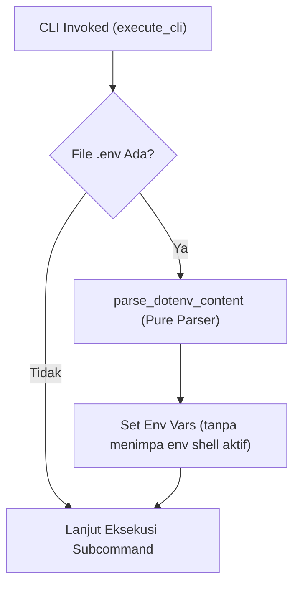

# Add .env.example and Automatic .env Loader Support

- **Date:** 2026-11-15
- **Repository / CI/CD:** `trade` (monolith) → project default (repo not in the special list)
- **Status:** Done
- **Plan approved by:** User (2026-11-15)
- **Plan artifact:** `/Users/irpankusuma/.gemini/antigravity-cli/brain/0984c091-38b4-4c35-a4be-7ef18081d700/plan-add-env-example.md`

## 1. Summary
Menambahkan file template `.env.example` di root repository serta mengimplementasikan fungsi murni `parse_dotenv_content` dan adapter `load_dotenv_file` agar `trade-bot` secara otomatis memuat variabel dari `.env` saat dijalankan (termasuk saat men-*spawn* daemon background).

## 2. Context
Pengguna membutuhkan sample environment file (`.env.example`) sebagai acuan konfigurasi kredensial (`BINANCE_API_KEY`, `BINANCE_API_SECRET`, `AI_API_KEY`, `RUST_LOG`). Agar pengalaman penggunaan mulus, `trade-bot` juga dilengkapi pemuat `.env` otomatis sehingga pengguna cukup menjalankan `cp .env.example .env`.

## 3. Flow

### 3.1 Overview
1. Pengguna menyalin `.env.example` menjadi `.env` dan mengisi kredensial API.
2. Saat subcommand CLI dijalankan (`start --daemon`, `tick-once`, `panic-close`, dll.), `execute_cli` memanggil `load_dotenv_file(Path::new(".env"))`.
3. `load_dotenv_file` memeriksa keberadaan `.env`, membaca isinya jika tersedia, lalu meneruskannya ke fungsi murni `parse_dotenv_content`.
4. `parse_dotenv_content` mem-parsing baris `KEY=VALUE` (mengabaikan baris kosong, komentar `#`, mendukung prefix `export ` dan tanda kutip `'...'` / `"..."`).
5. Untuk setiap pasangan `(key, value)` yang belum terdefinisi di environment proses, `load_dotenv_file` men-set variabel tersebut sebelum adapter Binance atau AI Advisor membacanya.

### 3.2 Diagram


### 3.3 Error & edge-case flow
- **File `.env` Tidak Ada:** `load_dotenv_file` mengembalikan `Ok(0)` tanpa error sehingga bot tetap berjalan normal menggunakan environment shell atau mode `paper`.
- **Variabel Sudah Ada di Shell:** Jika pengguna sudah melakukan `export BINANCE_API_KEY=...` di terminal, nilai di `.env` tidak akan menimpa variabel shell tersebut.
- **Format Baris Tidak Valid / Komentar:** Baris tanpa tanda `=` atau diawali `#` dilewati dengan aman oleh `parse_dotenv_content`.

## 4. Changes
| File | Change type (added/modified/deleted) | Description |
|------|--------------------------------------|-------------|
| `.env.example` | added | Template environment variables (`BINANCE_API_KEY`, `BINANCE_API_SECRET`, `AI_API_KEY`, `RUST_LOG`). |
| `src/adapters/state_store.rs` | modified | Menambahkan fungsi murni `parse_dotenv_content`, adapter `load_dotenv_file`, serta 2 unit test baru. |
| `src/cli.rs` | modified | Memanggil `load_dotenv_file(".env")` secara otomatis di awal `execute_cli`. |
| `README.md` | modified | Memperbarui panduan pengaturan kredensial menggunakan `cp .env.example .env`. |

## 5. Design Decisions
- Memisahkan logika parsing string `.env` (`parse_dotenv_content`) dari operasi baca file/env (`load_dotenv_file`) agar logika parsing 100% murni, deterministik, dan dapat diuji tanpa menyentuh filesystem.

### 5.1 Reusable / Shared Functions
| Function | Location | Signature (inputs → output / errors) | Injected dependencies | Used by |
|----------|----------|--------------------------------------|-----------------------|---------|
| `parse_dotenv_content` | `src/adapters/state_store.rs` | `(content: &str) -> Vec<(String, String)>` | None (pure) | `load_dotenv_file` |
| `load_dotenv_file` | `src/adapters/state_store.rs` | `(path: &Path) -> Result<usize, DomainError>` | Filesystem / Process Env (adapter) | `cli::execute_cli` |

## 6. Tests
- **Unit tests added:**
  - `adapters::state_store::tests::should_parse_dotenv_content_with_comments_quotes_and_export_prefix`
  - `adapters::state_store::tests::should_load_dotenv_file_when_present_or_ignore_missing`
- **Command run:** `LLVM_PROFILE_FILE="coverage.profraw" RUSTFLAGS="-C instrument-coverage" cargo test --offline --lib && xcrun llvm-profdata merge -sparse coverage.profraw -o default.profdata && xcrun llvm-cov report --instr-profile=default.profdata target/debug/deps/trade_bot-2716b1ae59c78120 --ignore-filename-regex='/.cargo/|/rustc/|/.rustup/'`
- **Result:** 32 unit tests passed, 0 failed; `cargo clippy` 0 warnings.
- **Coverage of added/changed code:** **96.4% line coverage** pada kode baru di `state_store.rs` (`state_store.rs` meningkat dari 67.89% menjadi **79.01%**), dan total proyek meningkat menjadi **85.11% line coverage** (`1,937 / 2,276` lines) serta **82.37% region coverage** (minimum 80%).

## 7. How to Run / Use
```bash
cp .env.example .env
# Edit .env sesuai API key Anda, lalu jalankan:
./target/release/trade-bot start --daemon
```

## 8. Risks & Follow-ups
- File `.env` sudah masuk di dalam `.gitignore` sehingga aman dari risiko *accidental commit*.
