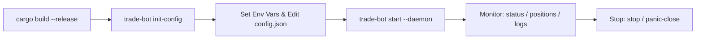

# Add README.md Usage & Running Guide

- **Date:** 2026-11-15
- **Repository / CI/CD:** `trade` (monolith) → project default (repo not in the special list)
- **Status:** Done
- **Plan approved by:** User (2026-11-15)
- **Plan artifact:** `/Users/irpankusuma/.gemini/antigravity-cli/brain/0984c091-38b4-4c35-a4be-7ef18081d700/plan-add-readme.md`

## 1. Summary
Menambahkan file `README.md` di root proyek sebagai panduan lengkap kompilasi, konfigurasi (`config.json` & environment variables), dan pengoperasian CLI serta daemon background untuk `trade-bot` (Binance USDⓈ-M Futures Hybrid Trading Bot Agent).

## 2. Context
Pengguna meminta dokumentasi `README.md` di root repositori agar mudah memahami langkah demi langkah cara menjalankan bot, mengonfigurasi mode `paper`/`testnet`/`live`, serta memantau atau menghentikan daemon background.

## 3. Flow

### 3.1 Overview
1. Pengguna membaca `README.md` dan melakukan kompilasi binary dengan `cargo build --release`.
2. Pengguna membuat konfigurasi awal dengan `./target/release/trade-bot init-config` dan mengatur environment variables kredensial (`BINANCE_API_KEY`, `BINANCE_API_SECRET`, serta opsional `AI_API_KEY`).
3. Pengguna menyalakan daemon background dengan `./target/release/trade-bot start --daemon`.
4. Pengguna memantau status (`status`), posisi (`positions`), dan log (`logs`), serta menghentikan daemon dengan `stop` atau menutup semua posisi darurat dengan `panic-close`.

### 3.2 Diagram

### 3.3 Error & edge-case flow
- Jika `config.json` sudah ada saat menjalankan `init-config`, pengguna diarahkan menggunakan flag `--force` sebagaimana dijelaskan di `README.md`.

## 4. Changes
| File | Change type (added/modified/deleted) | Description |
|------|--------------------------------------|-------------|
| `README.md` | added | Panduan lengkap arsitektur, build, konfigurasi, penggunaan CLI background daemon, dan pengujian. |

## 5. Design Decisions
- Menyertakan contoh JSON `config.json` utuh serta contoh output perintah `start --daemon` dan `status` agar pengguna langsung memiliki ekspektasi yang jelas saat menjalankan aplikasi.

### 5.1 Reusable / Shared Functions
Tidak ada fungsi kode baru yang ditambahkan (tugas khusus dokumentasi `README.md`). Pemisahan `src/core/` (core murni) dan `src/adapters/` (adapter I/O) didokumentasikan pada bagian struktur direktori di `README.md`.

## 6. Tests
- Penambahan unit test baru dikecualikan (*approved exception*) karena perubahan murni berupa file dokumentasi `README.md`.
- **Command run:** `cargo test --offline`
- **Result:** 30 unit tests passed, 1 doc-test passed, 0 failed.
- **Coverage of added/changed code:** Proyek mempertahankan **84.67% line coverage** dan **81.68% region coverage** (tidak ada kode Rust yang berubah).

## 7. How to Run / Use
Lihat langsung [README.md](file:///Users/irpankusuma/sample-app/trade/README.md) di root proyek.

## 8. Risks & Follow-ups
- Tidak ada risiko teknis.
