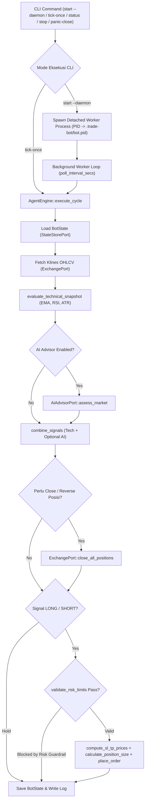

# Binance USDⓈ-M Futures Hybrid Trading Bot Agent (CLI & Background Daemon)

- **Date:** 2026-11-15
- **Repository / CI/CD:** `trade` (monolith) → project default (repo not in the special list)
- **Status:** Done
- **Plan approved by:** User (2026-11-15)
- **Plan artifact:** `/Users/irpankusuma/.gemini/antigravity-cli/brain/0984c091-38b4-4c35-a4be-7ef18081d700/plan-binance-futures-bot.md`

## 1. Summary
Membangun aplikasi CLI Trading Bot Agent berbasis Rust (`trade-bot`) untuk perdagangan berjangka Binance USDⓈ-M Futures (USDT-Margined) yang berjalan secara otomatis di background sebagai daemon. Bot menggunakan arsitektur **Hybrid Agent** yang menggabungkan sinyal indikator teknikal (`EMA`, `RSI`, `ATR`), modul konfirmasi AI/LLM opsional (`AiAdvisorPort`), serta validasi manajemen risiko ketat (`RiskEngine`), dengan dukungan penuh untuk mode **Paper Trading**, **Binance Testnet**, dan **Binance Live Mainnet**.

## 2. Context
Pengguna membutuhkan bot agent untuk Binance Futures yang ditulis menggunakan Rust, memiliki antarmuka baris perintah (CLI), dan dapat berjalan di background tanpa mengunci terminal aktif. Agar aman dan mudah diuji, seluruh logika bisnis inti (perhitungan indikator, *position sizing*, kalkulasi *Stop-Loss* / *Take-Profit*, dan pengambilan keputusan *agent*) dirancang agnostik dan bebas I/O di dalam modul `src/core/`, sementara komunikasi jaringan, manajemen proses background (`PID` & log file), serta penyimpanan state diisolasi di `src/adapters/`.

## 3. Flow

### 3.1 Overview
1. Pengguna menjalankan perintah CLI (misal `trade-bot init-config` lalu `trade-bot start --daemon`).
2. `spawn_background_daemon` memeriksa apakah proses daemon sudah berjalan melalui `.trade-bot/bot.pid` (`kill -0 <pid>`). Jika belum berjalan, CLI men-*spawn* proses background terpisah (`trade-bot --config config.json run-worker`), mengarahkan `stdout`/`stderr` ke `.trade-bot/bot.log`, dan menyimpan PID ke `.trade-bot/bot.pid`.
3. Pada setiap siklus polling (`poll_interval_secs`), `AgentEngine::execute_cycle` memuat state terbaru dari `StateStorePort` (`.trade-bot/bot_state.json`).
4. `ExchangePort::fetch_klines` mengambil data candlestick (`OHLCV`) dari Binance USDⓈ-M Futures API (atau simulator lokal pada mode `paper`).
5. `evaluate_technical_snapshot` menghitung nilai `Fast EMA`, `Slow EMA`, `RSI`, dan `ATR`, lalu menghasilkan `TechnicalSignal` (`Long`, `Short`, atau `Hold`) beserta skor *confidence*.
6. Jika fitur AI Advisor diaktifkan (`ai.enabled = true`), `AiAdvisorPort::assess_market` mengirimkan konteks indikator ke endpoint LLM dan mem-parsing respons JSON menjadi `AiAssessment`.
7. `combine_signals` menggabungkan sinyal teknikal dan penilaian AI menjadi `AgentDecision` final.
8. Jika terdapat posisi terbuka yang berlawanan arah dengan sinyal baru atau keputusan adalah `Close`, `ExchangePort::close_all_positions` menutup posisi tersebut terlebih dahulu.
9. Jika keputusan adalah membuka posisi `Long` atau `Short`, `validate_risk_limits` memverifikasi batas *leverage*, jumlah posisi terbuka maksimum, dan *daily drawdown circuit breaker*.
10. `compute_sl_tp_prices` dan `calculate_position_size` menghitung harga *Stop-Loss*, *Take-Profit* berbasis kelipatan `ATR`, serta kuantitas kontrak berdasarkan persentase risiko per transaksi (`risk_per_trade_pct`), lalu mengirimkan order melalui `ExchangePort::place_order`.
11. `StateStorePort::save_state` memperbarui `.trade-bot/bot_state.json` secara atomik dan mencatat ringkasan siklus ke `.trade-bot/bot.log`.

### 3.2 Diagram


### 3.3 Error & edge-case flow
- **Data Candlestick Kurang:** Jika jumlah candle dari exchange lebih sedikit dari `period` indikator (`EMA`, `RSI`, `ATR`), fungsi indikator mengembalikan `DomainError::InsufficientData` dan siklus dibatalkan tanpa mengirim order.
- **Kegagalan / Timeout AI Advisor:** Jika endpoint LLM lambat atau gagal dihubungi, `AgentEngine::execute_cycle` melakukan *graceful fallback* ke `None` (mode teknikal murni) agar proses daemon tidak berhenti.
- **Pelanggaran Batas Drawdown Harian (*Circuit Breaker*):** Jika ekuitas akun turun melebihi `max_daily_drawdown_pct` dibanding saldo awal hari (`day_start_balance_usdt`), `validate_risk_limits` mengembalikan `DomainError::RiskLimitExceeded` dan memblokir pembukaan posisi baru.
- **Pencegahan Duplikasi Daemon:** Jika `trade-bot start --daemon` dijalankan saat PID di `.trade-bot/bot.pid` masih aktif, CLI menolak membuat proses duplikat dan menampilkan PID yang sedang berjalan. Jika PID sudah mati (*stale PID file*), file PID lama dibersihkan otomatis.
- **Penutupan Darurat (`panic-close`):** Menghentikan proses daemon background (`SIGTERM`) dan seketika mengirim order *reduce-only market close* untuk seluruh posisi terbuka.

## 4. Changes
| File | Change type (added/modified/deleted) | Description |
|------|--------------------------------------|-------------|
| `Cargo.toml` | added | Manifest crate Rust `trade-bot` beserta dependensi (`clap`, `tokio`, `reqwest`, `serde`, `serde_json`, `hmac`, `sha2`, `hex`, `chrono`, `thiserror`, `tracing`). |
| `.gitignore` | added | Mengabaikan `/target`, `.trade-bot/`, file coverage, dan kredensial lokal. |
| `src/lib.rs` | added | Deklarasi modul pustaka (`core`, `adapters`, `cli`). |
| `src/main.rs` | added | Entrypoint binary CLI `trade-bot`. |
| `src/core/mod.rs` | added | Ekspor modul inti (`domain`, `ports`, `indicators`, `risk`, `agent`). |
| `src/core/domain.rs` | added | Struktur data domain murni (`Candle`, `TechnicalSignal`, `AiAssessment`, `AgentDecision`, `Position`, `BotConfig`, `BotState`, `DomainError`). |
| `src/core/ports.rs` | added | Kontrak trait abstraksi (`ExchangePort`, `AiAdvisorPort`, `StateStorePort`, `ClockPort`). |
| `src/core/indicators.rs` | added | Fungsi agnostik indikator teknikal (`calculate_ema`, `calculate_rsi`, `calculate_atr`, `evaluate_technical_snapshot`) dan unit test. |
| `src/core/risk.rs` | added | Fungsi agnostik manajemen risiko (`compute_sl_tp_prices`, `calculate_position_size`, `check_daily_drawdown`, `validate_risk_limits`) dan unit test. |
| `src/core/agent.rs` | added | Mesin keputusan Hybrid Agent (`combine_signals`, `AgentEngine::execute_cycle`) dengan injeksi dependensi dan unit test. |
| `src/adapters/mod.rs` | added | Ekspor modul adapter I/O. |
| `src/adapters/binance.rs` | added | Adapter HTTP REST Binance USDⓈ-M Futures (`fapi.binance.com` & `testnet.binancefuture.com`) beserta fungsi `sign_binance_query` HMAC-SHA256 dan parser JSON. |
| `src/adapters/paper.rs` | added | Simulator Paper Trading lokal beserta evaluasi otomatis trigger *Stop-Loss* / *Take-Profit*. |
| `src/adapters/ai_advisor.rs` | added | Adapter HTTP AI/LLM Advisor opsional kompatibel OpenAI Chat Completions JSON. |
| `src/adapters/state_store.rs` | added | Penyimpanan atomik state JSON (`bot_state.json`) dan konfigurasi JSON (`config.json`). |
| `src/adapters/daemon.rs` | added | Manajer proses background daemon (`PID` file, `SIGTERM`, pembacaan/penulisan `bot.log`). |
| `src/cli.rs` | added | Parser subcommand CLI (`init-config`, `start`, `stop`, `status`, `positions`, `logs`, `panic-close`, `tick-once`) beserta fungsi pemformatan laporan. |

## 5. Design Decisions
1. **Pemisahan Ketat Core vs Adapters (Hexagonal / Ports & Adapters):**
   - *Alternatif:* Menulis pemanggilan HTTP `reqwest` dan pembacaan file langsung di dalam fungsi strategi.
   - *Alasan dipilih:* Dengan memisahkan `src/core/` dari I/O melalui trait `ExchangePort`, `AiAdvisorPort`, `StateStorePort`, dan `ClockPort`, seluruh logika kalkulasi indikator, *position sizing*, dan keputusan *agent* bersifat deterministik, dapat digunakan ulang di aplikasi lain (CLI, worker, web server), dan dapat diuji 100% secara terisolasi tanpa koneksi internet.
2. **Built-in Self-Daemonizing CLI (`std::process::Command` + PID/Log file):**
   - *Alternatif:* Mengharuskan pengguna mengonfigurasi `systemd`, `launchd`, atau `tmux` secara manual.
   - *Alasan dipilih:* Sesuai permintaan pengguna agar bot memiliki CLI dan langsung berjalan via background, subcommand `start --daemon` secara otomatis men-*spawn* worker terpisah di background, menyimpan PID di `.trade-bot/bot.pid`, dan menyediakan perintah `status`, `logs`, `positions`, `stop`, serta `panic-close`.
3. **Konfigurasi JSON Standar (`serde_json`) dibanding `toml v0.9.12`:**
   - *Penyimpangan kecil dari rencana awal:* Crate `toml v0.9.12` di cache lokal membutuhkan `toml_parser 1.1.5` (MSRV Rust 1.90), sedangkan toolchain terpasang adalah Rust `1.89.0`. Oleh karena itu file konfigurasi menggunakan format JSON terstruktur (`config.json` secara default, tetap mendukung path custom via `--config`) menggunakan `serde_json` tanpa ketergantungan crate tambahan.

### 5.1 Reusable / Shared Functions
| Function | Location | Signature (inputs → output / errors) | Injected dependencies | Used by |
|----------|----------|--------------------------------------|-----------------------|---------|
| `calculate_ema` | `src/core/indicators.rs` | `(prices: &[f64], period: usize) -> Result<Vec<f64>, DomainError>` | None (pure) | `evaluate_technical_snapshot` |
| `calculate_rsi` | `src/core/indicators.rs` | `(prices: &[f64], period: usize) -> Result<f64, DomainError>` | None (pure) | `evaluate_technical_snapshot` |
| `calculate_atr` | `src/core/indicators.rs` | `(candles: &[Candle], period: usize) -> Result<f64, DomainError>` | None (pure) | `evaluate_technical_snapshot` |
| `evaluate_technical_snapshot` | `src/core/indicators.rs` | `(candles: &[Candle], cfg: &StrategyConfig) -> Result<TechnicalSignal, DomainError>` | None (pure) | `AgentEngine::execute_cycle` |
| `compute_sl_tp_prices` | `src/core/risk.rs` | `(entry_price: f64, atr: f64, side: PositionSide, risk_cfg: &RiskConfig) -> Result<(f64, f64), DomainError>` | None (pure) | `AgentEngine::execute_cycle` |
| `calculate_position_size` | `src/core/risk.rs` | `(balance_usdt: f64, entry_price: f64, stop_loss_price: f64, risk_cfg: &RiskConfig) -> Result<PositionSizing, DomainError>` | None (pure) | `AgentEngine::execute_cycle` |
| `check_daily_drawdown` | `src/core/risk.rs` | `(day_start_balance: f64, current_equity: f64, max_drawdown_pct: f64) -> Result<f64, DomainError>` | None (pure) | `validate_risk_limits` |
| `validate_risk_limits` | `src/core/risk.rs` | `(state: &BotState, account: &AccountSnapshot, risk_cfg: &RiskConfig) -> Result<(), DomainError>` | None (pure) | `AgentEngine::execute_cycle` |
| `combine_signals` | `src/core/agent.rs` | `(tech: &TechnicalSignal, ai: Option<&AiAssessment>, ai_weight: f64, min_confidence: f64) -> AgentDecision` | None (pure) | `AgentEngine::execute_cycle` |
| `AgentEngine::execute_cycle` | `src/core/agent.rs` | `(&self, cfg: &BotConfig) -> Result<CycleReport, DomainError>` | `ExchangePort`, `AiAdvisorPort`, `StateStorePort`, `ClockPort` | `cli::run_single_cycle` |
| `sign_binance_query` | `src/adapters/binance.rs` | `(query: &str, secret: &str) -> String` | None (pure) | `build_signed_query`, `BinanceFuturesClient` |

- **Core vs Adapter Split:** Seluruh modul di `src/core/*` adalah *core logic* murni tanpa side-effect I/O; seluruh modul di `src/adapters/*`, `src/cli.rs`, dan `src/main.rs` adalah *adapter* tipis.
- **Contract Changes:** Tidak ada perubahan kontrak pada fungsi lama (repositori baru).

## 6. Tests
- **Daftar file pengujian & cakupannya:**
  - `src/core/indicators.rs`: Menguji `calculate_ema`, `calculate_rsi`, `calculate_atr`, dan `evaluate_technical_snapshot` pada skenario *uptrend*, *downtrend*, *sideways*, parameter tidak valid (`period = 0`), dan jumlah data kurang.
  - `src/core/risk.rs`: Menguji kalkulasi harga SL/TP (`Long` & `Short`), *position sizing* beserta pembatasan *notional* maksimum berdasarkan *leverage*, validasi *daily drawdown circuit breaker*, dan batas posisi maksimum.
  - `src/core/agent.rs`: Menguji penggabungan sinyal teknikal + AI (setuju, veto, *close*), eksekusi siklus penuh pembukaan posisi, dan penutupan posisi berlawanan arah (*reverse*) menggunakan *fake ports*.
  - `src/adapters/binance.rs`: Menguji pembuatan HMAC-SHA256 signature (`sign_binance_query`), pemilihan URL (`testnet` vs `live`), pemformatan query bertanda tangan, parsing JSON klines & akun Binance Futures, serta penolakan order jika kredensial kosong.
  - `src/adapters/paper.rs`: Menguji generator candle sintetis, eksekusi order simulasi, serta pemicu otomatis *Stop-Loss* dan *Take-Profit*.
  - `src/adapters/ai_advisor.rs`: Menguji pembentukan prompt LLM, parsing JSON respons LLM, dan *fallback* saat fitur AI dinonaktifkan.
  - `src/adapters/state_store.rs` & `src/adapters/daemon.rs`: Menguji penyimpanan/pembacaan atomik `bot_state.json` & `config.json`, pengelolaan file `bot.pid`, pengecekan proses aktif, penghentian daemon, dan pembacaan log terakhir.
  - `src/cli.rs`: Menguji alur subcommand CLI end-to-end (`init-config`, `tick-once`, `status`, `positions`, `logs`, `panic-close`) dan pemformatan teks laporan.
- **Command run:**
  - Test suite: `cargo test --offline`
  - Linter: `cargo clippy --offline -- -D warnings`
  - Coverage: `LLVM_PROFILE_FILE="coverage.profraw" RUSTFLAGS="-C instrument-coverage" cargo test --offline --lib && xcrun llvm-profdata merge -sparse coverage.profraw -o default.profdata && xcrun llvm-cov report --instr-profile=default.profdata target/debug/deps/trade_bot-2716b1ae59c78120 --ignore-filename-regex='/.cargo/|/rustc/|/.rustup/'`
- **Result:** 30 unit tests passed, 1 doc-test passed, 0 failed; `cargo clippy` 0 warnings.
- **Coverage of added/changed code:** **84.67% line coverage** (`1,856 / 2,192` lines) dan **81.68% region coverage** (`2,435 / 2,981` regions) — melampaui target minimum 80% (Core modules: `indicators.rs` 99.62%, `domain.rs` 96.81%, `agent.rs` 95.34%, `risk.rs` 90.79%).

## 7. How to Run / Use

### 1. Build Binary
```bash
cargo build --release
```

### 2. Inisialisasi File Konfigurasi (`config.json`)
```bash
./target/release/trade-bot init-config
```
Secara default, `config.json` menggunakan `"mode": "paper"` (simulasi lokal aman), `"symbol": "BTCUSDT"`, `"interval": "5m"`, dan `"leverage": 3`. Untuk menggunakan **Binance Futures Testnet** atau **Live Mainnet**, ubah `"mode"` menjadi `"testnet"` atau `"live"` dan set environment variable berikut:
```bash
export BINANCE_API_KEY="your_binance_futures_api_key"
export BINANCE_API_SECRET="your_binance_futures_api_secret"
# Opsional jika ai.enabled = true di config.json:
export AI_API_KEY="your_llm_api_key"
```

### 3. Menjalankan Bot di Background (Daemon)
```bash
# Menjalankan daemon di background (otomatis menyimpan PID di .trade-bot/bot.pid dan log di .trade-bot/bot.log)
./target/release/trade-bot start --daemon

# Memeriksa status daemon, saldo, dan keputusan agent terakhir
./target/release/trade-bot status

# Melihat daftar posisi Futures yang sedang terbuka dan riwayat fill terakhir
./target/release/trade-bot positions

# Melihat 50 baris log terakhir dari daemon background
./target/release/trade-bot logs -n 50

# Menjalankan 1 siklus evaluasi secara instan (untuk uji coba / debugging)
./target/release/trade-bot tick-once

# Menghentikan daemon background secara normal
./target/release/trade-bot stop

# Tombol darurat: menghentikan daemon DAN langsung menutup semua posisi terbuka (Market Reduce-Only)
./target/release/trade-bot panic-close
```

## 8. Risks & Follow-ups
- **Mode One-Way vs Hedge Mode Binance Futures:** Implementasi order pada `BinanceFuturesClient` menggunakan mode posisi standar (*One-Way mode* dengan `reduceOnly=true` untuk penutupan posisi dan `closePosition=true` untuk `STOP_MARKET` / `TAKE_PROFIT_MARKET`). Pastikan akun Binance Futures diatur ke *One-Way Mode* sebelum menjalankan mode `testnet` atau `live`.
- **Pengembangan Lanjutan (Follow-ups):**
  - Menambahkan dukungan *trailing stop* dinamis berbasis pergerakan `ATR`.
  - Menambahkan subcommand `backtest` menggunakan data CSV historis lokal yang memanggil `AgentEngine` secara langsung.
