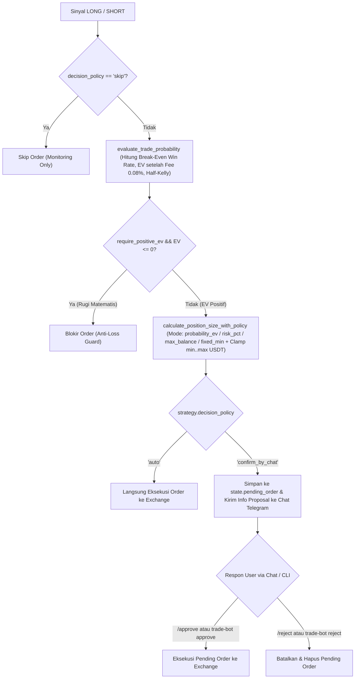

# Task: Kebijakan Keputusan (`decision_policy`), Batas Pembelian (`min`/`max`) & Kalkulasi Probabilitas Anti-Rugi (`Expected Value`)

- **Date:** 2026-11-15
- **Plan Reference:** `plan-configurable-decision-and-probability-sizing.md`

## Summary
Menambahkan konfigurasi kebijakan pengambilan keputusan order (`strategy.decision_policy`: `"auto"`, `"confirm_by_chat"`, `"skip"`), mode penentuan ukuran order (`risk.sizing_mode`: `"probability_ev"`, `"risk_pct"`, `"max_balance"`, `"fixed_min"`), batas pembelian minimum & maksimum (`risk.min_order_usdt`, `risk.max_order_usdt`), serta kalkulasi matematis **Probabilitas Menang, Break-Even Win Rate, Expected Value (EV) setelah fee, dan Half-Kelly Criterion** (`risk.require_positive_ev`). Dilengkapi pula dengan perintah persetujuan interaktif `/approve` (`/buy`) dan `/reject` melalui **Bot Telegram** maupun **CLI** (`trade-bot approve` / `trade-bot reject`).

## Context & Goal
Pengguna membutuhkan kontrol penuh atas:
1. **Pengambilan keputusan order:** apakah otomatis dieksekusi (`auto`), ditahan terlebih dahulu sambil mengirim informasi ke chat Telegram lalu baru dibeli saat disetujui lewat chat (`confirm_by_chat`), atau dilewati (`skip`).
2. **Batas pembelian & anti-rugi matematis:** membatasi nominal order minimum (`min_order_usdt`) dan maksimum sesuai saldo/angka tertentu (`max_order_usdt`), serta menghitung probabilitas menang dan *Expected Value (EV)* bersih setelah *fee* transaksi agar order yang merugi secara matematis otomatis ditolak.

## Changes Made
- [`src/core/domain.rs`](file:///Users/irpankusuma/sample-app/trade/src/core/domain.rs):
  - Menambahkan enum `DecisionPolicy` (`Auto`, `ConfirmByChat`, `Skip`) dan `SizingMode` (`ProbabilityEv`, `RiskPct`, `MaxBalance`, `FixedMin`).
  - Menambahkan struct `ProbabilityAssessment` (`win_probability`, `break_even_win_rate`, `net_reward_to_risk`, `expected_value_r`, `half_kelly_fraction`, `is_positive_ev`) dan `PendingOrderProposal`.
  - Memperbarui `StrategyConfig`, `RiskConfig`, `BotState`, dan `CycleReport`.
- [`src/core/risk.rs`](file:///Users/irpankusuma/sample-app/trade/src/core/risk.rs):
  - Mengimplementasikan fungsi murni `evaluate_trade_probability` (menghitung *Net R:R* setelah *round-trip taker fee* `0.08%`, *Break-Even Win Rate*, *Expected Value*, dan *Half-Kelly*).
  - Mengimplementasikan fungsi murni `calculate_position_size_with_policy` yang mendukung 4 `SizingMode` serta *clamping* terhadap `[min_order_usdt, max_order_usdt]`.
- [`src/core/agent.rs`](file:///Users/irpankusuma/sample-app/trade/src/core/agent.rs):
  - Memperbarui `AgentEngine::execute_cycle` untuk mengevaluasi probabilitas & EV serta mengeksekusi kebijakan `DecisionPolicy::Auto`, `DecisionPolicy::ConfirmByChat` (menyimpan `PendingOrderProposal` di `BotState`), atau `DecisionPolicy::Skip`.
- [`src/adapters/telegram.rs`](file:///Users/irpankusuma/sample-app/trade/src/adapters/telegram.rs) & [`src/cli.rs`](file:///Users/irpankusuma/sample-app/trade/src/cli.rs):
  - Menambahkan perintah `/approve` (`/buy`) dan `/reject` (`/cancel_order`) di Bot Telegram serta `trade-bot approve` dan `trade-bot reject` di CLI.
  - Memperbarui notifikasi Telegram, tampilan `status`, `monitor`, dan `config-info`.
- [`README.md`](file:///Users/irpankusuma/sample-app/trade/README.md) & [`HOW_IT_WORKS.md`](file:///Users/irpankusuma/sample-app/trade/HOW_IT_WORKS.md):
  - Mendokumentasikan parameter konfigurasi baru, rumus probabilitas/EV, dan diagram alur Mermaid.

## Flow
1. Pada setiap siklus evaluasi (`execute_cycle`), apabila sinyal `LONG` atau `SHORT` muncul dan `strategy.decision_policy != "skip"`, bot memeriksa batas risiko harian (`validate_risk_limits`) lalu menghitung harga *Stop-Loss* dan *Take-Profit* berbasis `ATR`.
2. Fungsi `evaluate_trade_probability` menghitung *Net Reward:Risk* setelah dikurangi *round-trip taker fee* (`0.08%`), *Break-Even Win Rate*, *Expected Value (EV)*, dan *Half-Kelly fraction*. Jika `risk.require_positive_ev = true` dan $\text{EV} \le 0$ (atau probabilitas menang $\le$ *Break-Even Win Rate*), transaksi otomatis dibatalkan agar tidak rugi secara ekspektasi matematis.
3. Fungsi `calculate_position_size_with_policy` menghitung nominal pembelian berdasarkan `risk.sizing_mode` (`probability_ev`, `risk_pct`, `max_balance`, atau `fixed_min`) dan membatasinya di antara `risk.min_order_usdt` dan `risk.max_order_usdt` (serta batas margin saldo $\times$ leverage).
4. Berdasarkan `strategy.decision_policy`:
   - **`"auto"`:** Order langsung dieksekusi ke exchange.
   - **`"confirm_by_chat"`:** Order disimpan sebagai `pending_order` di `bot_state.json`, detail proposal dikirim ke Telegram/CLI, dan baru dieksekusi saat pengguna mengirim `/approve` (atau dibatalkan dengan `/reject`).
   - **`"skip"`:** Pembukaan posisi baru dilewati.

## Verification & Test Results
- **Test command:** `cargo test --offline`
- **Result:** 40 unit tests passed, 0 failed; 1 doc-test passed.
- **Linter command:** `cargo clippy --offline -- -D warnings` (0 warnings).
- **Coverage (`xcrun llvm-cov report`):**
  - Total Line Coverage: **83.14%** (`3362` lines, `567` missed)
  - Total Region Coverage: **80.93%** (`4578` regions, `873` missed)
  - Core Engine Coverage: `core/indicators.rs` **99.62%**, `core/agent.rs` **94.33%**, `core/domain.rs` **90.08%**, `core/risk.rs` **88.76%**.

## Follow-ups / Known Limitations
- Saat `decision_policy = "confirm_by_chat"`, harga pasar dapat bergerak di antara waktu proposal dibuat dan waktu pengguna mengetik `/approve`. Eksekusi `/approve` menggunakan harga pasar terkini di mode `paper` atau order `MARKET` dengan SL/TP yang telah dihitung pada proposal.
