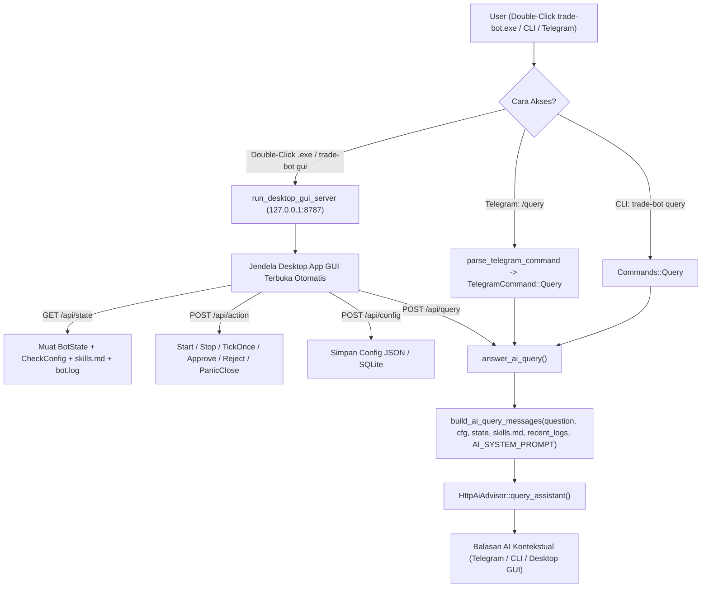

# Dokumentasi Task: Built-in Desktop App GUI (`trade-bot gui` & Double-Click `.exe`) & Fitur Tanya AI Langsung (`/query <text>`)

**Tanggal:** 2026-11-15  
**Status:** Executed  
**Cakupan Baris Kode Total (`llvm-cov`):** 81.15% (`core/indicators.rs`: 99.62%, `core/agent.rs`: 92.81%, `core/domain.rs`: 90.21%, `core/risk.rs`: 88.87%, `adapters/telegram.rs`: 85.71%, `adapters/ai_advisor.rs`: 83.14%)

---

## 1. Ringkasan (Summary)

Menambahkan dua fitur utama pada `trade-bot`:
1. **Built-in Desktop App GUI Mode (`trade-bot gui` & Auto-Launch saat Double-Click `trade-bot.exe`):**
   - Menjadikan `trade-bot gui` sebagai subcommand default ketika `trade-bot` atau `trade-bot.exe` dijalankan tanpa argumen (misalnya di-double-click langsung dari Windows Explorer).
   - Menyediakan antarmuka **Desktop App GUI** modern bertema gelap di `http://127.0.0.1:8787` dengan tombol kontrol 1-klik (`Start Daemon`, `Stop Daemon`, `Tick Once`, `Approve Order`, `Reject Order`, `Panic Close`), panel **Ask AI (`/query`)**, **Config Editor + `check-config`**, serta pembaruan otomatis untuk **Open Positions**, **Recent Fills**, **`skills.md`**, dan **Live Logs**.
2. **Fitur Tanya AI Langsung (`/query <text>`) dari Telegram, CLI, & Desktop GUI dengan `AI_SYSTEM_PROMPT` di `.env`:**
   - Menambahkan perintah `/query <pertanyaan>` (serta alias `/ask` dan `/ai`) di Telegram, perintah `trade-bot query "<pertanyaan>"` di CLI, dan kotak **Ask AI** di Desktop GUI.
   - Menyuntikkan konteks nyata bot (`BotConfig`, `BotState` termasuk saldo, PnL harian, posisi terbuka, riwayat fill, order tertunda, alasan sinyal terakhir, isi `skills.md`, serta 25 baris log terakhir `bot.log`) beserta system prompt yang dapat dikustomisasi lewat variabel environment `AI_SYSTEM_PROMPT` di `.env`.

---

## 2. Konteks (Context)

Sebelumnya, pengguna harus membuka terminal/PowerShell dan mengetik subcommand CLI untuk memantau atau mengontrol bot, serta belum dapat berdiskusi atau bertanya langsung kepada AI di dalam bot mengenai kondisi posisi, alasan keputusan strategi, maupun isi log. Dengan pembaruan ini:
- Pengguna Windows/macOS/Linux cukup melakukan **double-click `trade-bot.exe`** (atau menjalankan `./target/release/trade-bot gui`) untuk langsung membuka jendela aplikasi GUI Desktop tanpa perlu menghafal perintah terminal.
- Pengguna juga dapat bertanya langsung ke AI dari **Telegram** (`/query kenapa barusan hold?`), **CLI** (`trade-bot query "apa isi log terakhir?"`), maupun **Desktop GUI** dengan jawaban Bahasa Indonesia yang akurat berdasarkan data riil bot saat itu.

---

## 3. Alur Eksekusi (Flow)

### Langkah Berurutan (Numbered Steps)
1. **Peluncuran Aplikasi (`execute_cli`):**
   - Saat `trade-bot` dijalankan tanpa subcommand (seperti klik ganda `trade-bot.exe`), `cli.command` otomatis bernilai default `Commands::Gui { port: 8787, no_open: false }`.
2. **Server Desktop App GUI (`run_desktop_gui_server` & `handle_gui_http_request`):**
   - Membuka listener lokal di `127.0.0.1:8787` dan otomatis membuka jendela aplikasi (`cmd /C start`, `open`, atau `xdg-open`).
   - Melayani halaman dashboard HTML (`GET /`) serta endpoint JSON (`GET /api/state`, `POST /api/action`, `POST /api/query`, `POST /api/config`).
3. **Alur Tanya AI (`/query <text>`):**
   - Ketika pengguna mengirim `/query <pertanyaan>` dari Telegram, menjalankan `trade-bot query "<pertanyaan>"`, atau menekan tombol **Kirim ke AI** di Desktop GUI, fungsi `answer_ai_query` membaca `BotState`, `skills.md`, dan 25 baris terakhir `bot.log`.
   - `build_ai_query_messages` merakit `(system_prompt, user_prompt)` menggunakan nilai environment `AI_SYSTEM_PROMPT` (atau `default_trading_assistant_system_prompt()` jika tidak diset).
   - `HttpAiAdvisor::query_assistant` mengirim request ke endpoint OpenAI-compatible (`/v1/chat/completions`) dan mengembalikan jawaban AI ke Telegram/CLI/GUI.

### Diagram Alur (Mermaid)



---

## 4. Daftar Perubahan (Changes)

| File | Deskripsi Perubahan |
| :--- | :--- |
| [domain.rs](file:///Users/irpankusuma/sample-app/trade/src/core/domain.rs) | Menambahkan field `system_prompt_env: String` (default `"AI_SYSTEM_PROMPT"`) pada struct `AiConfig`. |
| [ai_advisor.rs](file:///Users/irpankusuma/sample-app/trade/src/adapters/ai_advisor.rs) | Menambahkan `default_trading_assistant_system_prompt`, `build_ai_query_messages`, `parse_ai_text_reply_json`, `HttpAiAdvisor::query_assistant`, dan unit test `should_build_ai_query_messages_and_parse_text_reply`. |
| [telegram.rs](file:///Users/irpankusuma/sample-app/trade/src/adapters/telegram.rs) | Menambahkan varian `TelegramCommand::Query(String)`, parsing `/query`, `/ask`, `/ai`, pembaruan `format_telegram_help()`, serta unit test. |
| [cli.rs](file:///Users/irpankusuma/sample-app/trade/src/cli.rs) | Menambahkan `Commands::Query`, `Commands::Gui`, default command ke `Commands::Gui` saat tanpa argumen, `answer_ai_query`, `build_desktop_dashboard_html`, `handle_gui_http_request`, `run_desktop_gui_server`, handler `/query` di loop Telegram, serta unit test. |
| [.env.example](file:///Users/irpankusuma/sample-app/trade/.env.example) | Menambahkan contoh variabel `AI_SYSTEM_PROMPT` beserta dokumentasinya. |
| [config.json](file:///Users/irpankusuma/sample-app/trade/config.json) | Menambahkan `"system_prompt_env": "AI_SYSTEM_PROMPT"` di bagian `ai`. |
| [WINDOWS_GUIDE.md](file:///Users/irpankusuma/sample-app/trade/WINDOWS_GUIDE.md) | Menambahkan panduan menjalankan aplikasi sebagai Desktop App GUI (double-click `trade-bot.exe` atau `trade-bot gui`). |
| [README.md](file:///Users/irpankusuma/sample-app/trade/README.md) | Mendokumentasikan perintah `trade-bot gui`, `trade-bot query`, `/query <pertanyaan>` di Telegram, dan konfigurasi `AI_SYSTEM_PROMPT`. |

---

## 5. Fungsi yang Dapat Digunakan Kembali (Reusable Functions)

| Fungsi | Lokasi | Tujuan |
| :--- | :--- | :--- |
| `default_trading_assistant_system_prompt()` | [src/adapters/ai_advisor.rs](file:///Users/irpankusuma/sample-app/trade/src/adapters/ai_advisor.rs#L172-L183) | Menghasilkan system prompt default asisten AI `trade-bot` jika `AI_SYSTEM_PROMPT` di `.env` kosong. |
| `build_ai_query_messages(...)` | [src/adapters/ai_advisor.rs](file:///Users/irpankusuma/sample-app/trade/src/adapters/ai_advisor.rs#L187-L299) | Merakit pasangan `(system_prompt, user_prompt)` yang kaya konteks (`BotConfig`, `BotState`, `skills.md`, dan `bot.log`). |
| `parse_ai_text_reply_json(...)` | [src/adapters/ai_advisor.rs](file:///Users/irpankusuma/sample-app/trade/src/adapters/ai_advisor.rs#L302-L320) | Mengekstrak teks jawaban asisten dari JSON response OpenAI-compatible (`/v1/chat/completions`). |
| `answer_ai_query(...)` | [src/cli.rs](file:///Users/irpankusuma/sample-app/trade/src/cli.rs#L734-L793) | Helper terpadu untuk menjawab pertanyaan AI baik dari Telegram (`/query`), CLI (`trade-bot query`), maupun Desktop GUI (`POST /api/query`). |
| `handle_gui_http_request(...)` | [src/cli.rs](file:///Users/irpankusuma/sample-app/trade/src/cli.rs#L971-L1190) | Router HTTP murni untuk melayani seluruh endpoint Desktop App GUI (`/`, `/api/state`, `/api/action`, `/api/query`, `/api/config`). |

---

## 6. Hasil Pengujian & Cakupan Kode (Test & Coverage Results)

- **Unit Tests & Doc-Tests:** `45 passed; 0 failed` (+ `1 doc-test passed`)
- **Clippy Linter:** `0 warnings` (`cargo clippy --offline -- -D warnings`)
- **Total Line Coverage (`xcrun llvm-cov`):** **81.15%** (`4988` baris total, melampaui target `>= 80%`)

---

## 7. Cara Menjalankan (How to Run)

```bash
# 1. Membuka Desktop App GUI (otomatis membuka jendela aplikasi di http://127.0.0.1:8787)
./target/release/trade-bot gui
# (Atau di Windows Explorer: cukup double-click file trade-bot.exe)

# 2. Bertanya langsung ke AI dari CLI
./target/release/trade-bot query "Kenapa keputusan terakhir HOLD dan bagaimana status posisi saat ini?"

# 3. Bertanya langsung ke AI dari Telegram (saat daemon berjalan)
# Kirim pesan ke bot Telegram Anda:
# /query apa isi log terakhir dan berapa win rate di skills.md?
```
