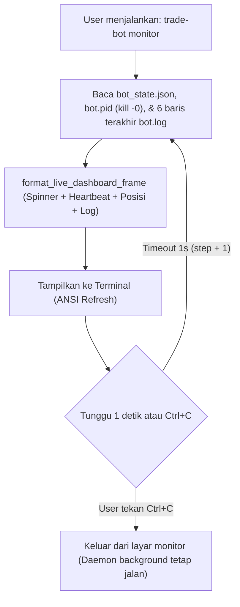

# Add Interactive Live CLI Monitor (`monitor`, `logs --follow`, & Live Progress Output)

- **Date:** 2026-11-15
- **Repository / CI/CD:** `trade` (monolith) → project default (repo not in the special list)
- **Status:** Done
- **Plan approved by:** User (2026-11-15)
- **Plan artifact:** `/Users/irpankusuma/.gemini/antigravity-cli/brain/0984c091-38b4-4c35-a4be-7ef18081d700/plan-interactive-cli-monitor.md`

## 1. Summary
Menambahkan fitur pemantauan interaktif *real-time* pada CLI `trade-bot` melalui subcommand `trade-bot monitor` (dashboard terminal live dengan animasi spinner, indikator *uptime* & *last tick*, saldo, posisi terbuka, dan *live log stream*), flag `trade-bot logs -f` (`--follow`), serta output progres siklus langsung di terminal saat dijalankan dengan `trade-bot start --foreground`.

## 2. Context
Pengguna menanyakan apakah saat CLI berjalan terdapat indikator interaktif yang menunjukkan bahwa aplikasi sedang bekerja/memproses siklus trading. Karena mode `start --daemon` berjalan di background, pengguna membutuhkan perintah interaktif (`trade-bot monitor` dan `trade-bot logs -f`) untuk melihat detak proses (*heartbeat*) dan aktivitas bot secara *real-time* kapan saja tanpa menghentikan daemon.

## 3. Flow

### 3.1 Overview
1. Pengguna menyalakan daemon di background dengan `trade-bot start --daemon` (yang kini menampilkan petunjuk langsung untuk membuka `trade-bot monitor`).
2. Saat pengguna menjalankan `trade-bot monitor`, CLI masuk ke loop interaktif yang setiap `refresh_ms` (default 1000ms) membaca `bot_state.json`, memeriksa proses aktif di `bot.pid`, dan mengambil 6 baris terakhir dari `bot.log`.
3. Fungsi murni `format_live_dashboard_frame` merender tampilan dashboard lengkap dengan karakter animasi spinner (`spinner_glyph`), status `🟢 [ACTIVE / RUNNING] (PID: ...)` atau `■ [STOPPED]`, waktu *last tick* dan *uptime* (`format_elapsed_duration`), daftar posisi Futures terbuka, serta *live stream* log.
4. Layar terminal diperbarui secara mulus menggunakan ANSI clear-screen (`\x1B[2J\x1B[H`).
5. Ketika pengguna menekan `Ctrl+C`, `trade-bot monitor` berhenti dengan bersih tanpa mematikan daemon background.

### 3.2 Diagram


### 3.3 Error & edge-case flow
- **Daemon Belum Berjalan:** Jika `trade-bot monitor` dibuka saat daemon mati, status menampilkan `■ [STOPPED]` beserta petunjuk menyalakan daemon (`trade-bot start --daemon`).
- **`last_tick_ms` Kosong:** `format_elapsed_duration(None, now_ms)` mengembalikan `"never"` dengan aman tanpa panic.

## 4. Changes
| File | Change type (added/modified/deleted) | Description |
|------|--------------------------------------|-------------|
| `src/cli.rs` | modified | Menambahkan fungsi murni `spinner_glyph`, `format_elapsed_duration`, `format_live_dashboard_frame`, subcommand `Monitor`, flag `Logs { follow }`, progres stdout pada `run_worker_loop`, dan unit test. |
| `README.md` | modified | Menambahkan contoh penggunaan `trade-bot monitor` dan `trade-bot logs -f`. |

## 5. Design Decisions
- Menggunakan ANSI escape sequence standar (`\x1B[2J\x1B[H`) dan fungsi perenderan string murni (`format_live_dashboard_frame`) dibanding library TUI berat agar bebas dependensi eksternal tambahan dan 100% dapat diuji dengan unit test deterministik (`max_frames`).

### 5.1 Reusable / Shared Functions
| Function | Location | Signature (inputs → output / errors) | Injected dependencies | Used by |
|----------|----------|--------------------------------------|-----------------------|---------|
| `spinner_glyph` | `src/cli.rs` | `(step: usize) -> &'static str` | None (pure) | `format_live_dashboard_frame`, `run_worker_loop` |
| `format_elapsed_duration` | `src/cli.rs` | `(from_ms: Option<i64>, now_ms: i64) -> String` | None (pure) | `format_live_dashboard_frame` |
| `format_live_dashboard_frame` | `src/cli.rs` | `(cfg: &BotConfig, state: &BotState, live_pid: Option<u32>, recent_logs: &[String], step: usize, now_ms: i64) -> String` | None (pure) | `execute_cli (Commands::Monitor)` |

## 6. Tests
- **Unit tests added/updated:**
  - `cli::tests::should_format_live_dashboard_frame_and_elapsed_durations`
  - `cli::tests::should_execute_cli_commands_init_tick_status_positions_logs_and_panic_close` (diperluas dengan pengujian `Commands::Monitor { refresh_ms: 10, max_frames: Some(2) }`)
- **Command run:** `LLVM_PROFILE_FILE="coverage.profraw" RUSTFLAGS="-C instrument-coverage" cargo test --offline --lib && xcrun llvm-profdata merge -sparse coverage.profraw -o default.profdata && xcrun llvm-cov report --instr-profile=default.profdata target/debug/deps/trade_bot-2716b1ae59c78120 --ignore-filename-regex='/.cargo/|/rustc/|/.rustup/' && cargo clippy --offline -- -D warnings`
- **Result:** 37 unit tests passed, 0 failed; `cargo clippy` 0 warnings.
- **Coverage of added/changed code:** **83.04% total line coverage** (`2,434 / 2,931` lines) dan **81.08% region coverage** (`3,243 / 4,000` regions) — melampaui target minimum 80%.

## 7. How to Run / Use
```bash
# 1. Jalankan daemon di background
./target/release/trade-bot start --daemon

# 2. Buka Live Interactive Activity Monitor (animasi spinner + detak proses + live log)
./target/release/trade-bot monitor

# 3. Atau ikuti aliran log secara live
./target/release/trade-bot logs -f
```

## 8. Risks & Follow-ups
- Menekan `Ctrl+C` pada `trade-bot monitor` atau `trade-bot logs -f` hanya menutup tampilan pemantau di terminal dan tidak menghentikan proses daemon background. Untuk menghentikan daemon, tetap gunakan `trade-bot stop` atau `trade-bot panic-close`.
