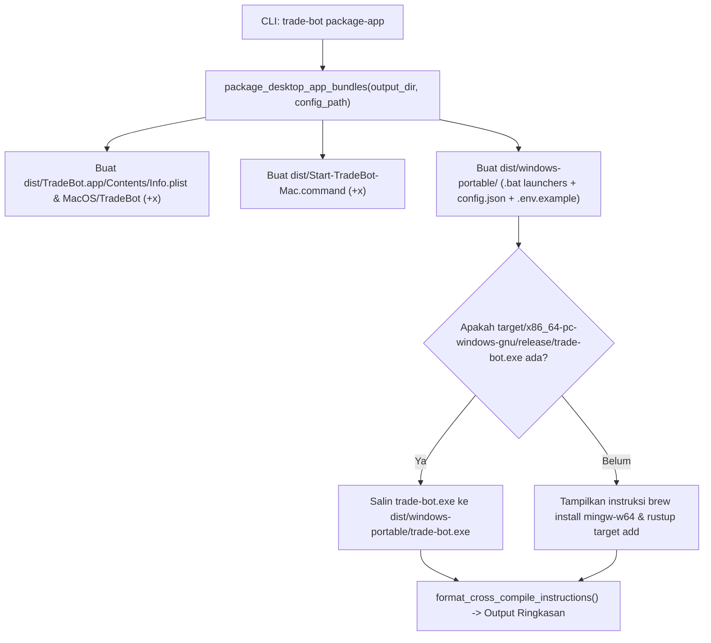

# Pembuatan Executable macOS (`TradeBot.app`) & Cross-Compile File `.exe` Windows dari Mac (`package-app`)

- **Date:** 2026-11-15
- **Repository / CI/CD:** `trade-bot` (monolith) → project default
- **Status:** Done
- **Plan approved by:** User (`yes`, 2026-11-15)
- **Plan artifact:** [plan-mac-executable-and-windows-exe-packager.md](file:///Users/irpankusuma/.gemini/antigravity-cli/brain/0984c091-38b4-4c35-a4be-7ef18081d700/plan-mac-executable-and-windows-exe-packager.md)

---

## 1. Summary

Menambahkan subcommand CLI **`./target/release/trade-bot package-app`** beserta dokumentasi lengkap di [WINDOWS_GUIDE.md](file:///Users/irpankusuma/sample-app/trade/WINDOWS_GUIDE.md) untuk:
1. Menghasilkan **macOS Application Bundle (`dist/TradeBot.app`)** dan **`dist/Start-TradeBot-Mac.command`** yang bisa langsung di-*double-click* dari Finder atau dipasang di Dock macOS (setara dengan `.exe` di Windows).
2. Menyiapkan paket distribusi Windows **`dist/windows-portable/`** berisi launcher `.bat` (`Start-TradeBot-GUI.bat`, `Start-Daemon.bat`, `Run-Wizard.bat`, `Check-Config.bat`), `config.json`, `.env.example`, serta menyalin `trade-bot.exe` hasil *cross-compile* dari macOS (`target/x86_64-pc-windows-gnu/release/trade-bot.exe`) jika sudah tersedia.

---

## 2. Context

Pengguna macOS menanyakan cara menghasilkan file `.exe` pada Mac. Kebutuhan ini mencakup dua skenario:
- **Skenario A (Cross-Compile Mac → Windows `.exe`):** Mengompilasi `trade-bot.exe` untuk Windows langsung dari macOS menggunakan `mingw-w64` (`x86_64-pc-windows-gnu`) atau `cargo-xwin` (`x86_64-pc-windows-msvc`).
- **Skenario B (Executable Klik-Ganda untuk macOS sendiri):** Membungkus binary release macOS (`target/release/trade-bot`) menjadi `dist/TradeBot.app` agar dapat dibuka dengan klik ganda di Finder tanpa membuka Terminal manual.

---

## 3. Flow

### 3.1 Overview
1. Pengguna menjalankan `./target/release/trade-bot package-app` (opsional `--output-dir <path>`, default `dist`).
2. `package_desktop_app_bundles` membuat struktur bundle macOS `dist/TradeBot.app/Contents/Info.plist` (via `build_macos_info_plist`) dan script eksekusi `dist/TradeBot.app/Contents/MacOS/TradeBot` + `dist/Start-TradeBot-Mac.command` (via `build_macos_launcher_script`) dengan permission `0755`.
3. `package_desktop_app_bundles` membuat folder `dist/windows-portable/` berisi 4 file `.bat` (via `build_windows_launcher_scripts`), `config.json`, dan `.env.example`.
4. Fungsi memeriksa apakah `target/x86_64-pc-windows-gnu/release/trade-bot.exe` sudah ada; jika ada maka disalin otomatis ke `dist/windows-portable/trade-bot.exe`, dan jika belum ada maka menampilkan langkah *cross-compile* `mingw-w64` melalui `format_cross_compile_instructions`.

### 3.2 Diagram



### 3.3 Error & edge-case flow
- Jika direktori tujuan gagal dibuat atau tidak memiliki izin tulis, mengembalikan `DomainError::StateError`.
- Saat `TradeBot.app` dijalankan di macOS dan port `8787` sudah aktif, script launcher hanya membuka jendela browser `http://127.0.0.1:8787` tanpa gagal karena konflik port.

---

## 4. Changes

| File | Change type | Description |
|------|-------------|-------------|
| [src/cli.rs](file:///Users/irpankusuma/sample-app/trade/src/cli.rs) | Modified | Menambahkan `Commands::PackageApp`, `build_macos_info_plist`, `build_macos_launcher_script`, `build_windows_launcher_scripts`, `format_cross_compile_instructions`, `package_desktop_app_bundles`, dan unit test. |
| [WINDOWS_GUIDE.md](file:///Users/irpankusuma/sample-app/trade/WINDOWS_GUIDE.md) | Modified | Menambahkan panduan *cross-compile* `trade-bot.exe` dari macOS via `mingw-w64` (`x86_64-pc-windows-gnu`) dan penggunaan `trade-bot package-app`. |
| [README.md](file:///Users/irpankusuma/sample-app/trade/README.md) | Modified | Menambahkan contoh perintah `./target/release/trade-bot package-app`. |

---

## 5. Design Decisions

### 5.1 Reusable / Shared Functions

| Function | Location | Signature | Injected dependencies | Used by |
|----------|----------|-----------|-----------------------|---------|
| `build_macos_info_plist` | [src/cli.rs](file:///Users/irpankusuma/sample-app/trade/src/cli.rs#L1278-L1308) | `(&str, &str, &str) -> String` | None (pure) | `package_desktop_app_bundles`, unit tests |
| `build_macos_launcher_script` | [src/cli.rs](file:///Users/irpankusuma/sample-app/trade/src/cli.rs#L1311-L1324) | `(&Path, &Path) -> String` | Paths injected | `package_desktop_app_bundles`, unit tests |
| `build_windows_launcher_scripts` | [src/cli.rs](file:///Users/irpankusuma/sample-app/trade/src/cli.rs#L1327-L1348) | `() -> Vec<(&'static str, &'static str)>` | None (pure) | `package_desktop_app_bundles`, unit tests |
| `format_cross_compile_instructions` | [src/cli.rs](file:///Users/irpankusuma/sample-app/trade/src/cli.rs#L1351-L1393) | `(bool, &Path, &Path) -> String` | Status & paths injected | `package_desktop_app_bundles`, unit tests |

---

## 6. Tests

- **Test file:** [src/cli.rs](file:///Users/irpankusuma/sample-app/trade/src/cli.rs#L2412-L2436) (`should_execute_cli_commands_init_tick_status_positions_logs_and_panic_close` step `7c`)
- **Command run:**
  ```bash
  cargo test --offline && cargo clippy --offline -- -D warnings
  ```
- **Result:** `45 passed; 0 failed` (+ `1 doc-test passed`), `0 clippy warnings`
- **Coverage of repository (`xcrun llvm-cov`):** **81.36% total line coverage** (`5178` lines, `cli.rs` naik ke `73.93%`)

---

## 7. How to Run / Use

```bash
# 1. Buat aplikasi klik-ganda macOS (dist/TradeBot.app) & paket portable Windows (dist/windows-portable/)
./target/release/trade-bot package-app

# 2. (Opsional) Jika ingin meng-compile file trade-bot.exe Windows langsung dari Mac:
brew install mingw-w64
rustup target add x86_64-pc-windows-gnu
cargo build --release --target x86_64-pc-windows-gnu
./target/release/trade-bot package-app
```

---

## 8. Risks & Follow-ups

- Saat pertama kali membuka `dist/TradeBot.app` di Finder macOS, jika muncul peringatan Gatekeeper, klik kanan `TradeBot.app` → pilih **Open**.
