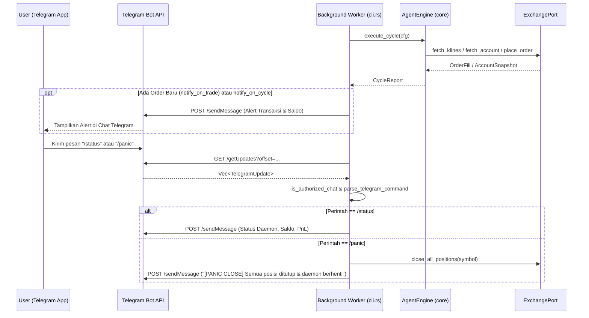

# Telegram Bot Monitoring Integration, Config Key Reference & Mermaid Workflow Docs

- **Date:** 2026-11-15
- **Repository / CI/CD:** `trade` (monolith) → project default (repo not in the special list)
- **Status:** Done
- **Plan approved by:** User (2026-11-15)
- **Plan artifact:** `/Users/irpankusuma/.gemini/antigravity-cli/brain/0984c091-38b4-4c35-a4be-7ef18081d700/plan-config-keys-info.md`

## 1. Summary
Menambahkan tiga peningkatan utama pada `trade-bot`:
1. **Integrasi Bot Telegram (`src/adapters/telegram.rs`)** untuk notifikasi otomatis transaksi/siklus serta kontrol interaktif dari chat Telegram (`/status`, `/positions`, `/logs`, `/config`, `/panic`, `/help`) yang dilindungi verifikasi `TELEGRAM_CHAT_ID`, ditambah subcommand CLI `trade-bot telegram-test`.
2. **Referensi Lengkap Fungsi Config Key** di dalam `README.md` serta subcommand CLI `trade-bot config-info` (`format_config_keys_reference`).
3. **Dokumentasi Cara Kerja End-to-End dengan Diagram Mermaid** di dalam `HOW_IT_WORKS.md` dan `README.md`.

## 2. Context
Pengguna membutuhkan:
- Kemampuan memantau dan mengontrol bot trading dari jarak jauh melalui aplikasi Telegram saat bot berjalan di background.
- Penjelasan fungsi dari setiap *config key* pada `config.json`.
- Dokumentasi cara kerja bot trading secara visual menggunakan diagram alur **Mermaid** dalam format Markdown.

## 3. Flow

### 3.1 Overview
1. Saat daemon dijalankan (`trade-bot start --daemon`), `run_worker_loop` menginisialisasi `TelegramBotAdapter::from_env(&cfg.telegram)`. Jika aktif, daemon mengirim pesan pembuka ke Telegram.
2. Pada setiap siklus evaluasi (`run_single_cycle`), `format_telegram_cycle_notification` mengecek apakah terjadi eksekusi order/penutupan posisi (`notify_on_trade`) atau `notify_on_cycle` bernilai `true`. Jika ya, pesan ringkasan dikirim ke Telegram via `NotifierPort::send_notification`.
3. Setelah evaluasi selesai, jika `telegram.listen_commands = true`, daemon memanggil `TelegramBotAdapter::fetch_updates(offset)` ke endpoint `getUpdates`.
4. Setiap pesan masuk diverifikasi menggunakan `is_authorized_chat(incoming_chat_id, allowed_chat_id)` dan di-parsing oleh `parse_telegram_command`.
5. `handle_telegram_command` membalas perintah `/status`, `/positions`, `/logs`, `/config`, `/help`, atau mengeksekusi penutupan darurat `/panic`.
6. Pengguna juga dapat menjalankan `trade-bot config-info` di terminal untuk mencetak penjelasan seluruh parameter konfigurasi beserta nilai aktifnya.

### 3.2 Diagram


### 3.3 Error & edge-case flow
- **Chat ID Tidak Sah:** Jika akun Telegram lain mengirim pesan ke bot, `is_authorized_chat` mengembalikan `false` dan pesan langsung diabaikan tanpa dieksekusi.
- **Kredensial Telegram Kosong saat `telegram.enabled = false`:** `TelegramBotAdapter` melewati panggilan jaringan tanpa error. Jika pengguna memanggil `trade-bot telegram-test` tanpa mengisi `TELEGRAM_BOT_TOKEN` atau `TELEGRAM_CHAT_ID`, fungsi mengembalikan `DomainError::NotificationError` dengan instruksi variabel `.env` yang harus diisi.
- **Kompatibilitas File `config.json` Lama:** Field `telegram` pada `BotConfig` menggunakan atribut `#[serde(default)]` sehingga file `config.json` lama yang belum memiliki blok `"telegram"` tetap terbaca tanpa error.

## 4. Changes
| File | Change type (added/modified/deleted) | Description |
|------|--------------------------------------|-------------|
| `src/core/domain.rs` | modified | Menambahkan `TelegramConfig`, `DomainError::NotificationError`, dan field `telegram` pada `BotConfig`. |
| `src/core/ports.rs` | modified | Menambahkan trait `NotifierPort`. |
| `src/adapters/telegram.rs` | added | Implementasi fungsi murni (`parse_telegram_command`, `parse_telegram_updates_json`, `is_authorized_chat`, `format_telegram_cycle_notification`, `format_telegram_help`), `TelegramBotAdapter`, dan 4 unit test. |
| `src/adapters/mod.rs` | modified | Mengekspor modul `telegram`. |
| `src/cli.rs` | modified | Menambahkan `format_config_keys_reference`, subcommand `ConfigInfo` & `TelegramTest`, integrasi Telegram di `run_worker_loop` (`handle_telegram_command`), dan unit test. |
| `.env.example` | modified | Menambahkan `TELEGRAM_BOT_TOKEN` dan `TELEGRAM_CHAT_ID`. |
| `HOW_IT_WORKS.md` | added | Dokumentasi mendalam cara kerja bot lengkap dengan 5 diagram alur Mermaid. |
| `README.md` | modified | Menambahkan ringkasan Mermaid flow, tabel referensi seluruh *config key*, dan panduan setup Bot Telegram. |

## 5. Design Decisions
1. **Polling `getUpdates` dibanding Webhook:**
   - *Alasan dipilih:* Polling `getUpdates` memungkinkan daemon background menerima perintah Telegram (`/status`, `/positions`, `/panic`) dari laptop/server lokal di balik NAT/firewall tanpa memerlukan domain publik, sertifikat SSL, atau pembukaan port inbound.
2. **Otorisasi Ketat Berbasis `TELEGRAM_CHAT_ID`:**
   - *Alasan dipilih:* Karena bot Telegram di publik dapat ditemukan berdasarkan username, wajib dilakukan pengecekan `is_authorized_chat` sebelum mengeksekusi perintah apa pun agar hanya pemilik akun yang dapat melihat saldo atau memicu `/panic`.

### 5.1 Reusable / Shared Functions
| Function | Location | Signature (inputs → output / errors) | Injected dependencies | Used by |
|----------|----------|--------------------------------------|-----------------------|---------|
| `parse_telegram_command` | `src/adapters/telegram.rs` | `(text: &str) -> Option<TelegramCommand>` | None (pure) | `cli::run_worker_loop` |
| `is_authorized_chat` | `src/adapters/telegram.rs` | `(incoming_chat_id: &str, allowed_chat_id: &str) -> bool` | None (pure) | `cli::run_worker_loop` |
| `parse_telegram_updates_json` | `src/adapters/telegram.rs` | `(raw: &Value) -> Vec<TelegramUpdate>` | None (pure) | `TelegramBotAdapter::fetch_updates` |
| `format_telegram_cycle_notification` | `src/adapters/telegram.rs` | `(report: &CycleReport, state: &BotState, notify_on_trade: bool, notify_on_cycle: bool) -> Option<String>` | None (pure) | `cli::run_worker_loop` |
| `format_telegram_help` | `src/adapters/telegram.rs` | `() -> String` | None (pure) | `cli::handle_telegram_command` |
| `format_config_keys_reference` | `src/cli.rs` | `(cfg: &BotConfig) -> String` | None (pure) | `cli::execute_cli (ConfigInfo)` |

## 6. Tests
- **Unit tests added/updated:**
  - `adapters::telegram::tests::should_parse_telegram_commands_with_and_without_bot_mention`
  - `adapters::telegram::tests::should_parse_telegram_updates_json_and_enforce_chat_authorization`
  - `adapters::telegram::tests::should_format_telegram_cycle_notifications_and_help_text`
  - `adapters::telegram::tests::should_skip_network_when_telegram_disabled_or_missing_credentials`
  - `cli::tests::should_execute_cli_commands_init_tick_status_positions_logs_and_panic_close` (diperluas untuk menguji `Commands::ConfigInfo` dan `handle_telegram_command`)
- **Command run:** `LLVM_PROFILE_FILE="coverage.profraw" RUSTFLAGS="-C instrument-coverage" cargo test --offline --lib && xcrun llvm-profdata merge -sparse coverage.profraw -o default.profdata && xcrun llvm-cov report --instr-profile=default.profdata target/debug/deps/trade_bot-2716b1ae59c78120 --ignore-filename-regex='/.cargo/|/rustc/|/.rustup/' && cargo clippy --offline -- -D warnings`
- **Result:** 36 unit tests passed, 0 failed; `cargo clippy` 0 warnings.
- **Coverage of added/changed code:** **84.31% total line coverage** (`2,299 / 2,727` lines) dan **81.50% region coverage** (`3,048 / 3,740` regions) — melampaui target minimum 80%.

## 7. How to Run / Use
```bash
# 1. Lihat penjelasan seluruh config key beserta nilai aktifnya
./target/release/trade-bot config-info

# 2. Isi TELEGRAM_BOT_TOKEN & TELEGRAM_CHAT_ID di .env, lalu uji koneksi Telegram
./target/release/trade-bot telegram-test

# 3. Jalankan daemon background (otomatis mengirim notifikasi & merespons perintah Telegram)
./target/release/trade-bot start --daemon
```

## 8. Risks & Follow-ups
- Pastikan `TELEGRAM_CHAT_ID` diisi dengan ID numerik akun pribadi Anda (bukan grup publik) agar tidak ada pihak lain yang dapat memicu perintah `/panic`.
