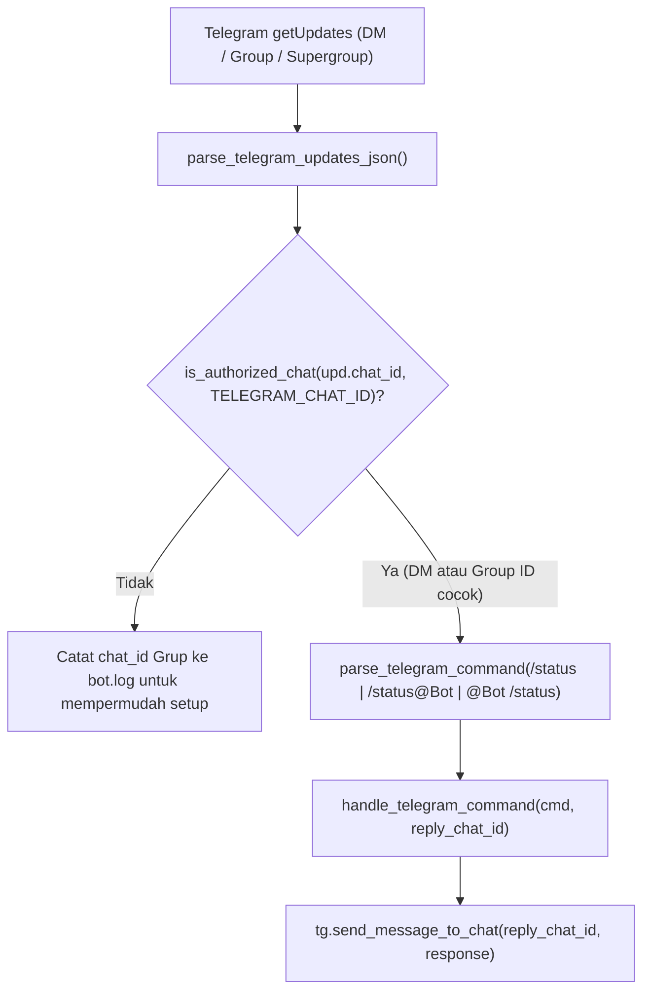

# Dukungan Penuh Grup & Supergroup Telegram (`/status`, `/query`, Multi-Chat ID DM + Group)

- **Date:** 2026-11-15
- **Repository / CI/CD:** `trade-bot` (monolith) → project default
- **Status:** Done
- **Plan approved by:** User (`yes`, 2026-11-15)
- **Plan artifact:** [plan-telegram-group-chat-support.md](file:///Users/irpankusuma/.gemini/antigravity-cli/brain/0984c091-38b4-4c35-a4be-7ef18081d700/plan-telegram-group-chat-support.md)

---

## 1. Summary

Menambahkan dukungan penuh penggunaan Bot Telegram di dalam **Grup / Supergroup Telegram** sekaligus di **Chat Pribadi (DM)** secara bersamaan:
1. **Multi-Chat ID Whitelist (`TELEGRAM_CHAT_ID=123456789,-100987654321`):** Mengizinkan otorisasi satu atau beberapa Chat ID (dipisahkan koma/titik koma) melalui `parse_allowed_chat_ids` dan `is_authorized_chat`.
2. **Reply Tepat ke Ruangan Pengirim (`send_message_to_chat`):** Ketika perintah `/status`, `/query`, `/positions`, `/actual-skill`, dll. diketik di dalam Grup, bot membalas langsung ke Grup tersebut; ketika diketik di Chat Pribadi, bot membalas ke Chat Pribadi.
3. **Format Mention Grup & Discovery ID Grup:** Mendukung `/status`, `/status@NamaBot`, maupun `@NamaBot /status` (serta `channel_post` / `edited_message`), dan otomatis mencatat `chat_id` grup yang belum terdaftar ke `bot.log` agar mudah disalin ke `.env`.

---

## 2. Context

Ketika bot dimasukkan ke dalam sebuah Grup Telegram, grup tersebut memiliki `chat_id` bernilai negatif (misal `-100987654321`) yang berbeda dari `chat_id` pribadi pengguna (`123456789`). Selain itu, anggota grup sering memanggil perintah dengan mention `@NamaBot /status` atau `/status@NamaBot`. Pembaruan ini memastikan kedua ruangan chat (Grup dan DM) dapat digunakan bersamaan tanpa bentrok.

---

## 3. Flow

### 3.1 Overview
1. Pesan masuk dari Telegram (`message`, `edited_message`, atau `channel_post`) diambil oleh `fetch_updates` dan diurai oleh `parse_telegram_updates_json` menjadi `TelegramUpdate { update_id, chat_id, text }`.
2. Worker memeriksa `is_authorized_chat(&upd.chat_id, tg.authorized_chat_id())` yang membandingkan `upd.chat_id` terhadap seluruh ID di dalam `TELEGRAM_CHAT_ID` (via `parse_allowed_chat_ids`).
3. Jika `chat_id` belum terdaftar, worker menulis baris bantuan di `bot.log` (`Telegram command ignored from unauthorized chat_id=-100... (add '-100...' to TELEGRAM_CHAT_ID in .env to authorize this Group/Chat)`).
4. Jika terotorisasi, `parse_telegram_command(&upd.text)` mengenali perintah baik dalam bentuk `/status`, `/status@NamaBot`, maupun `@NamaBot /status`.
5. `handle_telegram_command` mengeksekusi perintah dan mengirim balasan ke `upd.chat_id` asal menggunakan `tg.send_message_to_chat(reply_chat_id, ...)`.

### 3.2 Diagram



### 3.3 Error & edge-case flow
- Jika `TELEGRAM_CHAT_ID` berisi spasi di sekitar koma (`"123456789, -100987654321"`), `parse_allowed_chat_ids` otomatis melakukan `.trim()` dan mengabaikan elemen kosong.
- Pesan biasa di grup seperti `"halo semuanya"` atau `"@NamaBot halo"` yang bukan slash command diabaikan (`None`) sehingga bot tidak mengganggu percakapan grup.

---

## 4. Changes

| File | Change type | Description |
|------|-------------|-------------|
| [src/adapters/telegram.rs](file:///Users/irpankusuma/sample-app/trade/src/adapters/telegram.rs) | Modified | Menambahkan `parse_allowed_chat_ids`, memperbarui `is_authorized_chat`, `parse_telegram_command` (`@Bot /cmd`), `parse_telegram_updates_json` (`edited_message` & `channel_post`), `send_message_to_chat`, dan unit tests. |
| [src/cli.rs](file:///Users/irpankusuma/sample-app/trade/src/cli.rs) | Modified | Meneruskan `reply_chat_id` ke `handle_telegram_command` dan mencatat `chat_id` grup yang belum diotorisasi ke `bot.log`. |
| [.env.example](file:///Users/irpankusuma/sample-app/trade/.env.example) | Modified | Menambahkan contoh penggunaan multi-Chat ID (`123456789,-100987654321`). |
| [README.md](file:///Users/irpankusuma/sample-app/trade/README.md) | Modified | Menambahkan panduan menggunakan bot di Grup Telegram + Chat Pribadi sekaligus. |

---

## 5. Design Decisions

### 5.1 Reusable / Shared Functions

| Function | Location | Signature | Injected dependencies | Used by |
|----------|----------|-----------|-----------------------|---------|
| `parse_allowed_chat_ids` | [src/adapters/telegram.rs](file:///Users/irpankusuma/sample-app/trade/src/adapters/telegram.rs#L73-L80) | `(&str) -> Vec<String>` | None (pure) | `is_authorized_chat`, `send_notification` |
| `is_authorized_chat` | [src/adapters/telegram.rs](file:///Users/irpankusuma/sample-app/trade/src/adapters/telegram.rs#L84-L92) | `(&str, &str) -> bool` | None (pure) | `run_worker_loop`, unit tests |
| `parse_telegram_command` | [src/adapters/telegram.rs](file:///Users/irpankusuma/sample-app/trade/src/adapters/telegram.rs#L38-L69) | `(&str) -> Option<TelegramCommand>` | None (pure) | `run_worker_loop`, unit tests |

---

## 6. Tests

- **Test files:**
  - [src/adapters/telegram.rs](file:///Users/irpankusuma/sample-app/trade/src/adapters/telegram.rs#L385-L515) (`should_parse_telegram_commands_with_and_without_bot_mention`, `should_parse_telegram_updates_json_and_enforce_chat_authorization`)
  - [src/cli.rs](file:///Users/irpankusuma/sample-app/trade/src/cli.rs#L2464-L2480)
- **Command run:**
  ```bash
  cargo test --offline && cargo clippy --offline -- -D warnings
  ```
- **Result:** `45 passed; 0 failed` (+ `1 doc-test passed`), `0 clippy warnings`
- **Coverage (`xcrun llvm-cov`):** **80.85% total line coverage** (`5280` lines, `adapters/telegram.rs`: `83.93%`)

---

## 7. How to Run / Use

1. Masukkan bot Telegram Anda ke dalam Grup.
2. Ketik `/status` di dalam Grup.
3. Jika belum tahu angka `chat_id` Grup, cek log:
   ```bash
   ./target/release/trade-bot logs -n 10
   ```
   Salin angka `-100...` yang muncul ke `.env`:
   ```dotenv
   TELEGRAM_CHAT_ID=123456789,-100987654321
   ```
4. Restart daemon (`./target/release/trade-bot stop && ./target/release/trade-bot start --daemon`), lalu ketik `/status` atau `/query <pertanyaan>` langsung di Grup!

---

## 8. Risks & Follow-ups

- Semua anggota di dalam Grup yang telah diotorisasi di `TELEGRAM_CHAT_ID` dapat memanggil perintah bot di grup tersebut; pastikan hanya memasukkan bot ke grup pribadi/tim tepercaya Anda.
