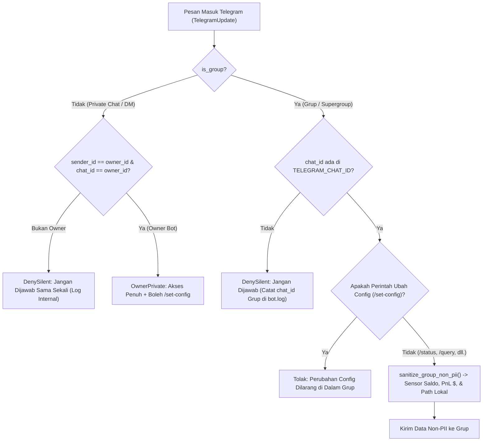

# Validasi Owner Private Chat (Silent Drop), Larangan Ubah Config & Proteksi Non-PII di Grup Telegram + Background Local Daemon

- **Date:** 2026-11-15
- **Repository / CI/CD:** `trade-bot` (monolith) → project default
- **Status:** Done
- **Plan approved by:** User (`cancel deployment di cloud deh, jalan di local server aja secara background. dan jalankan task lainnya`, 2026-11-15)
- **Plan artifact:** [plan-cloud-24h-and-telegram-owner-group-pii-guard.md](file:///Users/irpankusuma/.gemini/antigravity-cli/brain/0984c091-38b4-4c35-a4be-7ef18081d700/plan-cloud-24h-and-telegram-owner-group-pii-guard.md)

---

## 1. Summary

Mengimplementasikan tiga peningkatan keamanan dan privasi pada integrasi Bot Telegram:
1. **Validasi Ketat Private Chat — Hanya Owner Bot (`evaluate_telegram_access`):** Jika pesan masuk melalui Private Chat (DM) dari akun yang **bukan Owner Bot** (`TELEGRAM_OWNER_ID` atau ID personal positif pertama di `TELEGRAM_CHAT_ID`), bot **tidak menjawab sama sekali** (*silent ignore* — `TelegramAccessDecision::DenySilent`).
2. **Larangan Perubahan Config di Grup Telegram (`/set-config` & `/query` Guard):** Perintah perubahan konfigurasi (`/set-config <key> <value>` atau permintaan ubah config via `/query`) hanya diizinkan oleh **Owner di Private Chat**, dan otomatis **ditolak** jika dipanggil dari dalam Grup.
3. **Proteksi Data Non-PII di Grup Telegram (`sanitize_group_non_pii`):** Saat anggota bertanya di dalam Grup (`/status`, `/positions`, `/config`, `/logs`, `/actual-skill`, atau `/query`), seluruh informasi PII dan finansial pribadi (nominal saldo dompet USDT, PnL dolar pribadi, batas modal order, serta path direktori user OS `/Users/...`) otomatis disensor (`[REDACTED - NON-PII GROUP MODE]`).

---

## 2. Context

Ketika bot dioperasikan secara background di local server dan dimasukkan ke dalam Grup Telegram bersama pengguna lain, ada dua risiko utama:
- Orang asing yang mengetahui username bot bisa mencoba menghubungi bot lewat Private Chat (DM).
- Anggota di dalam Grup tidak boleh mengubah konfigurasi bot dan tidak boleh melihat data pribadi/PII milik Owner (seperti jumlah kekayaan/saldo USDT pribadi atau nama folder user di komputer lokal).

---

## 3. Flow

### 3.1 Overview
1. Setiap update dari `getUpdates` diurai oleh `parse_telegram_updates_json` menjadi `TelegramUpdate { update_id, chat_id, sender_id, is_group, text }`.
2. `evaluate_telegram_access(&upd, tg.owner_id(), tg.authorized_chat_id())` mengevaluasi hak akses:
   - Jika `!upd.is_group` (Private Chat): wajib `chat_id == owner_id` dan `sender_id == owner_id` → menghasilkan `TelegramAccessDecision::OwnerPrivate`. Jika bukan Owner → `TelegramAccessDecision::DenySilent` (bot diam & tidak membalas apa pun).
   - Jika `upd.is_group` (Group/Supergroup): memeriksa apakah `chat_id` grup terdaftar di `TELEGRAM_CHAT_ID` → menghasilkan `TelegramAccessDecision::AuthorizedGroup` (atau `DenySilent` jika grup belum terdaftar).
3. Di dalam `handle_telegram_command`:
   - Jika `AuthorizedGroup` memanggil `/set-config` atau meminta ubah config lewat `/query`, bot menolak perubahan konfigurasi.
   - Jika `AuthorizedGroup` memanggil `/status`, `/positions`, `/logs`, `/config`, `/actual-skill`, atau `/query`, output disaring terlebih dahulu melalui `sanitize_group_non_pii` sebelum dikirim ke grup.

### 3.2 Diagram



### 3.3 Error & edge-case flow
- Jika `TELEGRAM_OWNER_ID` tidak diisi di `.env`, `resolve_owner_user_id` secara otomatis mengambil ID positif (non-grup) pertama dari `TELEGRAM_CHAT_ID`.
- Jika `/set-config` diberikan key yang tidak valid oleh Owner di Private Chat, `apply_telegram_config_mutation` mengembalikan daftar key yang didukung (`symbol`, `interval`, `decision_policy`, `min_order_usdt`, `max_order_usdt`, `leverage`).

---

## 4. Changes

| File | Change type | Description |
|------|-------------|-------------|
| [src/adapters/telegram.rs](file:///Users/irpankusuma/sample-app/trade/src/adapters/telegram.rs) | Modified | Menambahkan `TelegramAccessDecision`, `TelegramCommand::SetConfig`, `resolve_owner_user_id`, `evaluate_telegram_access`, `sanitize_group_non_pii`, field `sender_id` & `is_group` pada `TelegramUpdate`, serta unit test `should_enforce_owner_only_in_private_chat_and_non_pii_in_group_chat`. |
| [src/cli.rs](file:///Users/irpankusuma/sample-app/trade/src/cli.rs) | Modified | Menambahkan `apply_telegram_config_mutation` dan menerapkan `evaluate_telegram_access` serta `sanitize_group_non_pii` pada `run_worker_loop` dan `handle_telegram_command`. |
| [.env.example](file:///Users/irpankusuma/sample-app/trade/.env.example) | Modified | Menambahkan dokumentasi `TELEGRAM_OWNER_ID`. |
| [README.md](file:///Users/irpankusuma/sample-app/trade/README.md) | Modified | Mendokumentasikan aturan Private Owner-Only, larangan `/set-config` di Grup, dan proteksi Non-PII di Grup. |

---

## 5. Design Decisions

### 5.1 Reusable / Shared Functions

| Function | Location | Signature | Injected dependencies | Used by |
|----------|----------|-----------|-----------------------|---------|
| `resolve_owner_user_id` | [src/adapters/telegram.rs](file:///Users/irpankusuma/sample-app/trade/src/adapters/telegram.rs#L103-L111) | `(&str, &str) -> Option<String>` | None (pure) | `evaluate_telegram_access`, `TelegramBotAdapter::new` |
| `evaluate_telegram_access` | [src/adapters/telegram.rs](file:///Users/irpankusuma/sample-app/trade/src/adapters/telegram.rs#L117-L143) | `(&TelegramUpdate, &str, &str) -> TelegramAccessDecision` | None (pure) | `run_worker_loop`, unit tests |
| `sanitize_group_non_pii` | [src/adapters/telegram.rs](file:///Users/irpankusuma/sample-app/trade/src/adapters/telegram.rs#L147-L190) | `(&str) -> String` | None (pure) | `handle_telegram_command`, unit tests |
| `apply_telegram_config_mutation` | [src/cli.rs](file:///Users/irpankusuma/sample-app/trade/src/cli.rs#L1995-L2055) | `(&mut BotConfig, &str, &str) -> Result<String, String>` | Config struct injected | `handle_telegram_command`, unit tests |

---

## 6. Tests

- **Test files:**
  - [src/adapters/telegram.rs](file:///Users/irpankusuma/sample-app/trade/src/adapters/telegram.rs#L629-L699) (`should_enforce_owner_only_in_private_chat_and_non_pii_in_group_chat`)
  - [src/cli.rs](file:///Users/irpankusuma/sample-app/trade/src/cli.rs#L2759-L2797)
- **Command run:**
  ```bash
  cargo test --offline && cargo clippy --offline -- -D warnings
  ```
- **Result:** `46 passed; 0 failed` (+ `1 doc-test passed`), `0 clippy warnings`
- **Coverage (`xcrun llvm-cov`):** **81.03% total line coverage** (`5555` lines)

---

## 7. How to Run / Use (Background di Local Server)

```bash
# Jalankan worker di background local server
./target/release/trade-bot start --daemon

# Cek status worker yang sedang berjalan di background
./target/release/trade-bot status
```

---

## 8. Risks & Follow-ups

- Pastikan `TELEGRAM_OWNER_ID` (atau ID positif pertama di `TELEGRAM_CHAT_ID`) adalah User ID Telegram pribadi Anda agar Anda memiliki akses penuh saat chat secara private ke bot.
