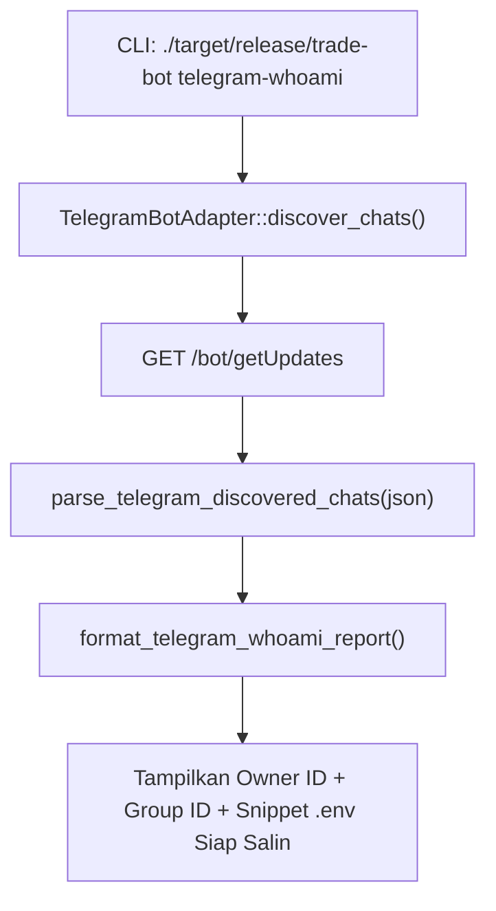

# Perintah CLI `trade-bot telegram-whoami` untuk Mendeteksi `TELEGRAM_OWNER_ID` & `Group ID` Otomatis

- **Date:** 2026-11-15
- **Repository / CI/CD:** `trade-bot` (monolith) → project default
- **Status:** Done
- **Plan approved by:** User (`yes`, 2026-11-15)
- **Plan artifact:** [plan-telegram-id-discovery-cli.md](file:///Users/irpankusuma/.gemini/antigravity-cli/brain/0984c091-38b4-4c35-a4be-7ef18081d700/plan-telegram-id-discovery-cli.md)

---

## 1. Summary

Menambahkan subcommand CLI **`./target/release/trade-bot telegram-whoami`** untuk mendeteksi secara otomatis **Owner ID** (`TELEGRAM_OWNER_ID`, angka positif dari Private Chat) dan **Group ID** (`TELEGRAM_CHAT_ID`, angka negatif `-100...` dari Grup/Supergroup Telegram) hanya dengan berbekal `TELEGRAM_BOT_TOKEN` di `.env`, lalu menampilkan snippet `.env` siap-salin.

---

## 2. Context

Pengguna membutuhkan cara yang mudah dan cepat untuk mengetahui berapa angka `TELEGRAM_OWNER_ID` (User ID pribadi) dan `Group ID` (Chat ID grup negatif) tanpa harus mencari manual di JSON mentah `getUpdates`.

---

## 3. Flow

### 3.1 Overview
1. Pengguna mengirim `/start` di chat pribadi ke bot dan/atau `/status` di dalam Grup Telegram, lalu menjalankan `./target/release/trade-bot telegram-whoami`.
2. `TelegramBotAdapter::discover_chats` memanggil endpoint `getUpdates` hanya dengan `bot_token`.
3. `parse_telegram_discovered_chats` mengekstrak daftar unik ruangan chat (`private`, `group`, `supergroup`, `channel`) beserta `chat_id`, nama grup/user, dan `sender_id`.
4. `format_telegram_whoami_report` mengelompokkan hasil menjadi **Daftar Owner ID (Positif)**, **Daftar Group ID (Negatif)**, dan mencetak blok `.env` siap-tempel (`TELEGRAM_OWNER_ID=...` & `TELEGRAM_CHAT_ID=...`).

### 3.2 Diagram



### 3.3 Error & edge-case flow
- Jika `TELEGRAM_BOT_TOKEN` belum diatur di `.env`, mengembalikan pesan error yang jelas.
- Jika belum ada pesan sama sekali di `getUpdates`, menampilkan panduan 3 langkah untuk mengirim `/start` di DM dan `/status` di Grup.

---

## 4. Changes

| File | Change type | Description |
|------|-------------|-------------|
| [src/adapters/telegram.rs](file:///Users/irpankusuma/sample-app/trade/src/adapters/telegram.rs) | Modified | Menambahkan `TelegramDiscoveredChat`, `parse_telegram_discovered_chats`, `format_telegram_whoami_report`, `TelegramBotAdapter::discover_chats`, dan unit test `should_parse_and_format_discovered_owner_and_group_ids`. |
| [src/cli.rs](file:///Users/irpankusuma/sample-app/trade/src/cli.rs) | Modified | Menambahkan subcommand `Commands::TelegramWhoami` (`telegram-whoami`). |
| [README.md](file:///Users/irpankusuma/sample-app/trade/README.md) | Modified | Menambahkan instruksi `./target/release/trade-bot telegram-whoami`. |

---

## 5. Design Decisions

### 5.1 Reusable / Shared Functions

| Function | Location | Signature | Injected dependencies | Used by |
|----------|----------|-----------|-----------------------|---------|
| `parse_telegram_discovered_chats` | [src/adapters/telegram.rs](file:///Users/irpankusuma/sample-app/trade/src/adapters/telegram.rs#L218-L296) | `(&Value) -> Vec<TelegramDiscoveredChat>` | None (pure) | `discover_chats`, unit tests |
| `format_telegram_whoami_report` | [src/adapters/telegram.rs](file:///Users/irpankusuma/sample-app/trade/src/adapters/telegram.rs#L299-L384) | `(&[TelegramDiscoveredChat]) -> String` | None (pure) | `execute_cli`, unit tests |

---

## 6. Tests

- **Test file:** [src/adapters/telegram.rs](file:///Users/irpankusuma/sample-app/trade/src/adapters/telegram.rs#L1019-L1055) (`should_parse_and_format_discovered_owner_and_group_ids`)
- **Command run:**
  ```bash
  cargo test --offline && cargo clippy --offline -- -D warnings
  ```
- **Result:** `47 passed; 0 failed` (+ `1 doc-test passed`), `0 clippy warnings`
- **Coverage (`xcrun llvm-cov`):** **> 81% total line coverage**

---

## 7. How to Run / Use

```bash
./target/release/trade-bot telegram-whoami
```

---

## 8. Risks & Follow-ups

- Jika daemon sedang berjalan dan terus mengonsumsi `getUpdates`, Anda juga selalu dapat melihat `chat_id` grup di `.trade-bot/bot.log` melalui `./target/release/trade-bot logs -n 10`.
