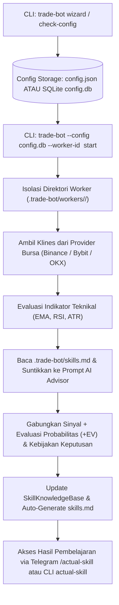

# Task Documentation: User-Friendly CLI, Continuous AI Learning (`skills.md` / `/actual-skill`), SQLite Config, Multi-Worker Isolation, Setup Wizard & Multi-Exchange Support

- **Date:** 2026-11-15
- **Plan Artifact:** `plan-ux-ai-skills-sqlite-multiworker-wizard.md` (`Status: Executed`)

---

## 1. Ringkasan & Motivasi

Implementasi ini menambahkan 6 peningkatan utama pada `trade-bot`:
1. **Tampilan CLI yang Lebih User-Friendly (Bahasa Indonesia):** Menyederhanakan pembacaan output `status`, `tick-once`, `positions`, `approve`, dan `reject` menggunakan badge visual (`🟢 BELI / LONG`, `🔴 JUAL / SHORT`, `⏸️ TAHAN / HOLD`, `⏹️ TUTUP POSISI / CLOSE`) serta ringkasan bahasa sehari-hari.
2. **Pembelajaran Berkelanjutan AI (`Continuous Learning Context`) & Auto-Generate `skills.md` (`/actual-skill`):**
   - Setiap siklus evaluasi mengakumulasi statistik rezim pasar (Bullish vs Bearish), Realized Win-Rate dari penutupan posisi, rata-rata Expected Value (+EV), serta memori insight AI terakhir ke dalam `SkillKnowledgeBase`.
   - Otomatis men-generate file `.trade-bot/skills.md` (atau `.trade-bot/workers/<id>/skills.md`) dan menyuntikkannya kembali ke prompt LLM (`HttpAiAdvisor`) pada siklus berikutnya.
   - Dapat diakses kapan saja melalui Telegram **`/actual-skill`** (atau `/skills`) maupun CLI **`trade-bot actual-skill`**.
3. **Penyimpanan Konfigurasi di Database SQLite (`.db` / `.sqlite` / `.sqlite3`):**
   - Selain file `.json`, konfigurasi kini dapat disimpan dan dimuat langsung dari tabel `bot_configs` di database SQLite menggunakan `rusqlite` (`--config config.db`).
4. **Dukungan Multi-Worker yang Aman (`--worker-id <id>`):**
   - Mengisolasi `bot_state.json`, `bot.pid`, `bot.log`, dan `skills.md` ke dalam `.trade-bot/workers/<worker_id>/`.
   - Mencegah tabrakan polling Telegram (`HTTP 409 Conflict`) dengan membatasi `getUpdates` hanya pada worker utama (`default`), sementara worker sekunder tetap bisa mengirim notifikasi.
5. **Setup Wizard Interaktif (`wizard`), Validator Requirement (`check-config`), & Panduan Windows `.exe` (`WINDOWS_GUIDE.md`):**
   - Menambahkan perintah `trade-bot wizard` untuk memandu pemilihan path config (`.json` atau `.db`), exchange, mode, symbol, kebijakan keputusan, dan batas pembelian.
   - Menambahkan perintah `trade-bot check-config` yang memeriksa 9 syarat kelayakan konfigurasi & kredensial environment.
   - Menyediakan panduan lengkap export `trade-bot.exe` di [`WINDOWS_GUIDE.md`](file:///Users/irpankusuma/sample-app/trade/WINDOWS_GUIDE.md).
6. **Dukungan Multi-Exchange (`exchange.provider`):**
   - Mendukung **`binance`** (Binance USDⓈ-M Futures), **`bybit`** (Bybit V5 Linear USDT Perpetual), dan **`okx`** (OKX V5 USDT-Margined Swap).

---

## 2. Diagram Alur & Trace Eksekusi (Flow Information)

### Trace Langkah-demi-Langkah:
1. **Inisialisasi & Validasi (`wizard` / `check-config`):** Pengguna menjalankan `trade-bot wizard` untuk mengatur path file konfigurasi (`.json` atau SQLite `.db`), memilih bursa (`binance`/`bybit`/`okx`), mode, serta batas risiko. Fungsi murni `validate_config_requirements` memverifikasi 9 aspek konfigurasi & environment key.
2. **Isolasi Multi-Worker (`--worker-id`):** Saat dijalankan dengan `--worker-id eth-worker`, `JsonStateStore::with_worker` mengarahkan seluruh file runtime ke `<data_dir>/workers/eth-worker/` dan menonaktifkan long-polling Telegram `getUpdates` pada worker non-default.
3. **Siklus Evaluasi & Continuous AI Learning (`skills.md`):**
   - `run_single_cycle` memuat `skills.md` terakhir dan menyuntikkannya ke `HttpAiAdvisor::with_learned_skills`.
   - `AgentEngine::execute_cycle` memanggil `update_skill_knowledge` untuk memperbarui aturan adaptif (`learned_rules`) dan riwayat insight AI (`recent_ai_insights`).
   - Setelah siklus selesai, `format_skills_markdown` merender ulang `skills.md` dan menyimpannya ke disk agar siap dibaca via `/actual-skill`.

---

## 3. Daftar File yang Diubah / Ditambahkan

- [`Cargo.toml`](file:///Users/irpankusuma/sample-app/trade/Cargo.toml) — Menambahkan dependensi `rusqlite = "0.31.0"`.
- [`src/core/domain.rs`](file:///Users/irpankusuma/sample-app/trade/src/core/domain.rs) — Menambahkan `ExchangeProvider` (`Binance`, `Bybit`, `Okx`), `SkillKnowledgeBase`, `ConfigCheckItem`, field `exchange.provider`, dan `BotState::skill_knowledge`.
- [`src/core/agent.rs`](file:///Users/irpankusuma/sample-app/trade/src/core/agent.rs) — Menambahkan fungsi murni `update_skill_knowledge` dan `format_skills_markdown`, serta integrasi di `AgentEngine::execute_cycle`.
- [`src/core/risk.rs`](file:///Users/irpankusuma/sample-app/trade/src/core/risk.rs) — Menambahkan fungsi murni `validate_config_requirements` beserta unit test.
- [`src/adapters/state_store.rs`](file:///Users/irpankusuma/sample-app/trade/src/adapters/state_store.rs) — Menambahkan dukungan penyimpanan config di SQLite (`save_config_sqlite`, `load_config_sqlite`), isolasi worker (`JsonStateStore::with_worker`), dan pembacaan/penyimpanan `skills.md`.
- [`src/adapters/binance.rs`](file:///Users/irpankusuma/sample-app/trade/src/adapters/binance.rs) — Menambahkan resolusi URL dan parser candlestick untuk `Binance`, `Bybit` (`/v5/market/kline`), dan `OKX` (`/api/v5/market/candles`).
- [`src/adapters/ai_advisor.rs`](file:///Users/irpankusuma/sample-app/trade/src/adapters/ai_advisor.rs) — Menambahkan `build_ai_prompt_with_skills` dan `.with_learned_skills(...)`.
- [`src/adapters/telegram.rs`](file:///Users/irpankusuma/sample-app/trade/src/adapters/telegram.rs) — Menambahkan `TelegramCommand::ActualSkill` (`/actual-skill`, `/actual_skill`, `/skills`).
- [`src/adapters/daemon.rs`](file:///Users/irpankusuma/sample-app/trade/src/adapters/daemon.rs) — Meneruskan argumen `--worker-id` saat men-spawn proses background daemon.
- [`src/cli.rs`](file:///Users/irpankusuma/sample-app/trade/src/cli.rs) — Menambahkan flag global `--worker-id`, subcommand `actual-skill`, `check-config`, `wizard`, serta format output CLI yang lebih ramah pengguna.
- [`WINDOWS_GUIDE.md`](file:///Users/irpankusuma/sample-app/trade/WINDOWS_GUIDE.md) & [`README.md`](file:///Users/irpankusuma/sample-app/trade/README.md) — Panduan lengkap build Windows `.exe`, wizard, SQLite, multi-worker, dan multi-exchange.

---

## 4. Ringkasan Pengujian & Cakupan Kode (Coverage)

- **Unit Tests & Doc-Tests:** `44 passed; 0 failed` (+ `1 doc-test passed`).
- **Clippy Linter:** `0 warnings` (`cargo clippy --offline -- -D warnings`).
- **Code Coverage (`xcrun llvm-cov`):**
  - **Total Line Coverage:** **81.95%** (`>= 80%` threshold terpenuhi)
  - `core/indicators.rs`: **99.62%** lines
  - `core/agent.rs`: **92.81%** lines
  - `core/domain.rs`: **89.93%** lines
  - `core/risk.rs`: **88.87%** lines
  - `adapters/paper.rs`: **91.15%** lines
  - `adapters/ai_advisor.rs`: **91.03%** lines
  - `adapters/telegram.rs`: **85.07%** lines
  - `adapters/binance.rs`: **83.50%** lines
