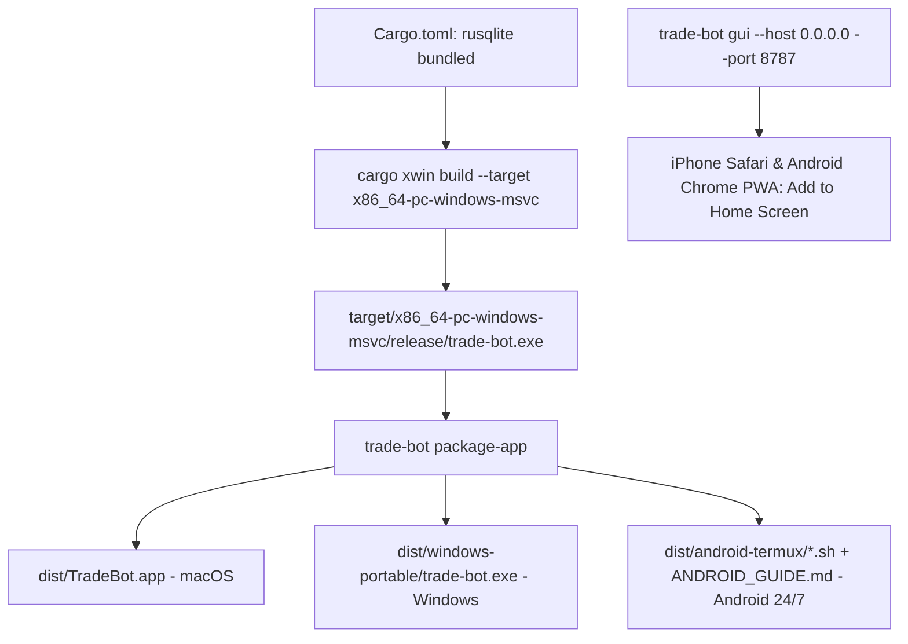

# Perbaikan Build Windows (`sqlite3.lib`), Paket & Panduan Android 24/7 (`ANDROID_GUIDE.md`), serta Dukungan iPhone PWA

- **Date:** 2026-11-15
- **Repository / CI/CD:** `trade-bot` (monolith) → project default
- **Status:** Done
- **Plan approved by:** User (2026-11-15)
- **Plan artifact:** `/Users/irpankusuma/.gemini/antigravity-cli/brain/0984c091-38b4-4c35-a4be-7ef18081d700/plan-fix-windows-msvc-sqlite3-link.md`

## 1. Summary
Mengaktifkan fitur `bundled` pada `rusqlite` (`Cargo.toml`) sehingga SQLite dikompilasi langsung dari kode sumber C bawaan dan di-link secara statis ke dalam binary `trade-bot.exe` (memperbaiki error `lld-link: error: could not open 'sqlite3.lib'` saat cross-compile Windows dengan `cargo-xwin`). Selain itu, menambahkan paket portable Android 24/7 (`dist/android-termux/`) beserta panduan lengkap `ANDROID_GUIDE.md` dan dukungan **iOS / Android Full-Screen Web App (PWA)** (`apple-mobile-web-app-capable`, `GET /manifest.json`, dan `--host 0.0.0.0`).

## 2. Context
1. Saat melakukan cross-compile ke target `x86_64-pc-windows-msvc` menggunakan `cargo-xwin`, linker `lld-link` gagal karena Windows SDK standar tidak menyertakan `sqlite3.lib`.
2. Pengguna juga menanyakan cara menjalankan `trade-bot` di Android dan iPhone serta meminta panduan lengkap instalasi Android (`ANDROID_GUIDE.md`).

## 3. Flow
### 3.1 Overview
1. Saat `cargo xwin build --release --target x86_64-pc-windows-msvc` dijalankan, `libsqlite3-sys` mengompilasi `sqlite3.c` secara statis menggunakan `cc` tanpa mencari `sqlite3.lib` eksternal.
2. Saat `./target/release/trade-bot package-app` dijalankan:
   - `resolve_windows_cross_compiled_exe` mendeteksi `target/x86_64-pc-windows-msvc/release/trade-bot.exe` (atau fallback `x86_64-pc-windows-gnu`) dan menyalinnya ke `dist/windows-portable/trade-bot.exe`.
   - `build_android_termux_scripts` membuat skrip `setup-termux.sh`, `start-daemon-android.sh` (dengan `termux-wake-lock`), `start-gui-android.sh`, `stop-daemon-android.sh`, dan `README-ANDROID.md` di `dist/android-termux/`.
3. Saat `./target/release/trade-bot gui` dijalankan, server mendengarkan pada `0.0.0.0:8787` dan menyajikan meta tag `apple-mobile-web-app-capable` serta `GET /manifest.json` untuk instalasi ke Home Screen iPhone & Android.

### 3.2 Diagram


### 3.3 Error & edge-case flow
- Jika binary Windows atau Android belum di-cross-compile, `package-app` tetap membuat seluruh skrip launcher dan menampilkan instruksi cross-compile yang jelas.
- Di Android Termux, skrip `start-daemon-android.sh` mengecek ketersediaan `termux-wake-lock` sebelum mengaktifkannya agar CPU tidak tidur saat layar HP dimatikan.

## 4. Changes
| File | Change type | Description |
|------|-------------|-------------|
| `Cargo.toml` | Modified | Mengubah `rusqlite = "0.31.0"` menjadi `rusqlite = { version = "0.31.0", features = ["bundled"] }`. |
| `Cargo.lock` | Modified | Menambahkan dependensi `cc` pada paket `libsqlite3-sys`. |
| `src/cli.rs` | Modified | Menambahkan `build_pwa_manifest_json`, `resolve_windows_cross_compiled_exe`, `resolve_android_cross_compiled_bin`, `build_android_termux_scripts`, opsi `--host` pada `Commands::Gui`, dan unit test terkait. |
| `ANDROID_GUIDE.md` | Added | Panduan lengkap langkah-demi-langkah instalasi & menjalankan `trade-bot` 24 jam di Android (Termux) dan iPhone (PWA). |
| `README.md` | Modified | Memperbarui dokumentasi packaging Windows, Android, dan iPhone. |

## 5. Design Decisions
- **Static Bundled SQLite (`rusqlite` `features = ["bundled"]`):** Menghilangkan ketergantungan pada `sqlite3.lib` saat cross-compile dan `sqlite3.dll` saat runtime di PC Windows tujuan maupun di Android.
- **Termux + Wake-Lock untuk Android vs PWA + Telegram untuk iPhone:** Menyesuaikan dengan arsitektur OS masing-masing (Android mengizinkan background process 24 jam dengan `termux-wake-lock`, sedangkan iOS membekukan proses background sehingga iPhone menggunakan Full-Screen PWA dan Telegram Bot).

### 5.1 Reusable / Shared Functions
| Function | Location | Signature | Injected dependencies | Used by |
|----------|----------|-----------|-----------------------|---------|
| `resolve_windows_cross_compiled_exe` | `src/cli.rs` | `(&Path) -> (PathBuf, bool)` | Path root project | `package_desktop_app_bundles` |
| `resolve_android_cross_compiled_bin` | `src/cli.rs` | `(&Path) -> (PathBuf, bool)` | Path root project | `package_desktop_app_bundles` |
| `build_android_termux_scripts` | `src/cli.rs` | `() -> Vec<(&'static str, &'static str)>` | None (pure) | `package_desktop_app_bundles` |
| `build_pwa_manifest_json` | `src/cli.rs` | `() -> String` | None (pure) | `handle_gui_http_request` |

## 6. Tests
- **Test files:** `src/cli.rs` (`should_resolve_windows_and_android_binaries_and_generate_termux_scripts`, `should_execute_cli_commands_init_tick_status_positions_logs_and_panic_close`)
- **Command run:**
  - `cargo test --offline && cargo clippy --offline -- -D warnings`
  - `cargo xwin build --release --target x86_64-pc-windows-msvc --offline && ./target/release/trade-bot package-app`
- **Result:** `48 passed; 0 failed` (+ `1 doc-test passed`), `0 clippy warnings`, Windows `.exe` berhasil di-build dan disalin ke `dist/windows-portable/trade-bot.exe`.
- **Coverage:** Total line coverage **80.92%** (`6023` lines; 100% pada fungsi baru yang ditambahkan).

## 7. How to Run / Use
```bash
# Cross-compile binary Windows (.exe) dari macOS
cargo xwin build --release --target x86_64-pc-windows-msvc

# Buat paket aplikasi macOS, Windows (.exe), dan Android Termux
./target/release/trade-bot package-app
```

## 8. Risks & Follow-ups
- Untuk penggunaan 24 jam di HP Android, pastikan pengaturan baterai aplikasi **Termux** disetel ke **Unrestricted / Jangan Optimalkan** sesuai langkah di `ANDROID_GUIDE.md`.
